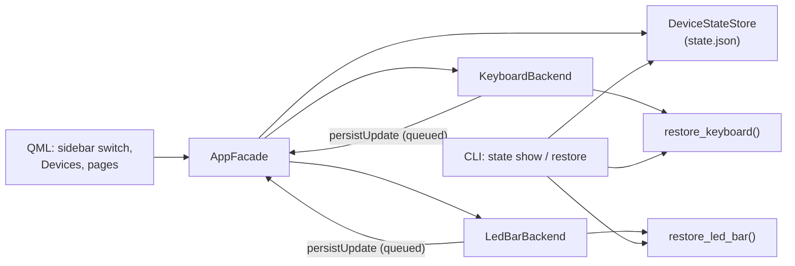

# Spec: Remembered devices and startup look

Status: Draft — awaiting user approval · Date: 2026-10-06 · Language: English (`.compozy/` artifacts are English-only by user decision)

---

# Part I — Product

## Overview

- **Motivating Problem**: every time the GUI opens, the lights lose what the user set up. The app auto-connects to "the first device of each kind" through a global setting, nothing about the look is kept, and the user must re-apply effects, colours or animations by hand. The sidebar always lists Keyboard and LED bar, its switch connects/disconnects, and power on/off lives in page footers.
  **Simplest end-to-end outcome:** the user connects a device once on the Devices page; from then on, opening the app reconnects it and re-applies the last look the user applied (animations included), and the sidebar switch turns that device's light on and off.
- **Who**: the owner of an Avell Storm laptop who uses the desktop GUI; secondarily, a script or agent using the CLI.
- **Why**: the lights look the way the user left them, with no repeated setup and fewer controls to think about.

## Goals

- Connecting a device on **Devices** remembers it and adds it to the sidebar.
- Opening the app reconnects remembered devices and applies their **saved look** and **light state**.
- The **last successfully applied look** of each device is saved automatically. There is no save button.
- The sidebar switch turns the **light** on/off. Footer **Power on / Power off** buttons disappear.
- **Disconnect** forgets the device (no reconnect at startup) but keeps its saved look for a later reconnect.
- The CLI can **show** and **restore** the saved state without the GUI.
- The **Auto-connect** setting becomes unnecessary and is removed without losing the user's current behaviour.

## User Stories

- US-001–US-004 — Device memory: connect/remember, reconnect at startup, disconnect/forget, remembered device unavailable.
- US-005–US-007 — Saved look: keyboard auto-save, LED bar auto-save, restore at startup.
- US-008 — Light toggle (replaces footer power buttons).
- US-009–US-010 — CLI: show and restore saved state.
- US-011–US-012 — Upgrade from the auto-connect setting; unreadable state file.
- [Full user stories](_user_stories.md)

## Core Features

**F1 — Device memory**
- Connecting on Devices remembers the device (kind + USB id) and shows it in the sidebar.
- Disconnecting on Devices releases USB, forgets it and removes it from the sidebar.
- A remembered device that is absent or fails to open stays in the sidebar as **unavailable**, with **Retry** and **Forget**.

**F2 — Saved look (automatic)**
- After each successful apply in the GUI, the device's look is saved. Failed applies never overwrite it.
- Keyboard looks: firmware effect, solid colour, per-key grid, animation file. Keyboard extras: palette slots written by the app and global brightness.
- LED bar look: palette, effect, brightness, speed — the full parameter set after the last apply.

**F3 — Startup restore**
- After the startup scan, each remembered and present device is connected. Then its palette/brightness, light state and look are applied, in a fixed order (Business Rules BR-10).

**F4 — Light toggle**
- The sidebar switch shows and sets the light state. **On** re-applies the saved look; **off** turns the light off. The light state is saved too.

**F5 — CLI state commands**
- `avell-storm-rgb state show [--json]` and `avell-storm-rgb state restore [--kind …] [--no-animation] [--json]` read the same saved state.

**F6 — Migration**
- The first start of the new version converts the old **Auto-connect** behaviour into remembered devices.

**Interactions:** F2 feeds F3, F4 and F5. F4 writes the light state that F3 and F5 apply. F1 decides which devices F3 and F5 touch.

## Business Rules

- **BR-1** At most **one remembered device per kind** (`keyboard`, `led_bar`). Connecting another device of the same kind replaces the remembered USB id; the saved look stays (it belongs to the kind).
- **BR-1a** A device becomes remembered only when **Connect on Devices succeeds**. A failed Connect shows an error and remembers nothing.
- **BR-2** Device identity is **kind + USB vendor:product** in lowercase hex (`048d:ce00`). Bus/address are never saved. When several present devices match, the first in scan order is used.
- **BR-3** A device has a **sidebar entry iff it is remembered**. Its configuration tabs are usable only while it is **connected**.
- **BR-4** A look is saved **only after its USB apply returned without error**. The last successful apply wins.
- **BR-5** What counts as a look:
  - Keyboard: `firmware_effect` (effect, speed, brightness, color, direction, reactive, save) · `solid` (RGB) · `per_key` (cells in **device** coordinates) · `animation` (absolute path, loops, forever).
  - Keyboard extras, saved independently of the look: **palette slots** written by the app (1–7) and **global brightness** (0–50).
  - **Not** a look (never saved, never change the saved look): follow-screen, demo test pattern, freeze.
  - LED bar: `palette` (1–9 RGB), `effect`, `brightness` (0–100), `speed` (1–10).
- **BR-6** Light state is `on` / `off` per device. Toggling saves it. At startup: `off` → the device is turned off and the look is **not** applied; `on` → the look is applied.
- **BR-7** Toggle **on** re-applies the saved look. Without a saved look: keyboard → re-sends the effect captured at the last toggle-off in this session, else firmware effect `rainbow` with builder defaults; LED bar → power-on sequence only.
- **BR-8** Applying any look while the light is off turns the light **on**. The light state is saved and the switch updates.
- **BR-9** **Disconnect** = release USB + forget (`remembered = false`) + remove the sidebar entry. The saved look and light state are **kept** and come back on a later connect of the same kind.
- **BR-10** Startup restore order: load state → USB scan → **LED bar** first, then **keyboard**. Per device: palette slots → brightness → light off **or** look. A keyboard **animation** is always queued last.
- **BR-11** A running animation or follow-screen is **stopped first** when the user toggles the keyboard light off, applies a new keyboard look, or disconnects the keyboard.
- **BR-12** Saved animation file missing or unreadable at restore → the look is not applied, a warning names the file, the saved look is kept, and the light state is still applied.
- **BR-13** CLI device commands (`keyboard effect`, `led-bar color`, …) **do not** change the saved state. `state restore` applies the saved state and never modifies it.
- **BR-14** Migration, once, at the first GUI start with **no state file**:
  - legacy setting `ui/autoConnectOnStartup` absent or true → connect and remember the first discovered keyboard and LED bar, light `on`, no look;
  - legacy setting false → remember nothing.
  - The legacy key is deleted afterwards, either way.
- **BR-15** Unreadable or unsupported state file:
  - **GUI:** renames it to `state.json.invalid` (replacing an older one), starts with empty state, and shows an error naming the reason and the backup path.
  - **CLI:** reports the error (exit code 3) and changes nothing.

## User Experience

**Persona:** the laptop owner. They want the lights to "just stay as I left them", and they prefer fewer controls and no extra save steps (ADHD-friendly).

**Flows**

1. **First run after upgrade:** the app opens and, from the old auto-connect, remembers the keyboard and LED bar. Both appear in the sidebar with their light switches.
2. **Set and forget:** the user picks a firmware effect or plays an animation; it is saved silently. Next day, opening the app restores it.
3. **Lights off at night:** the user flips the switch off and quits. Next open: the lights stay off and the switch shows off. Flipping on restores the look.
4. **Stop using the LED bar:** Devices → Disconnect. The entry leaves the sidebar, and the app no longer touches the bar at startup.
5. **Device missing** (bar unplugged / other machine): the sidebar entry shows *unavailable*; its page offers **Retry** and **Forget**.

**Accessibility:** each switch has an accessible name ("Keyboard light", "LED bar light"). The unavailable state is conveyed by text, not only by colour.

**Discoverability:** the Devices hint says connecting remembers the device. The UI surface map is in [_uiux.md](_uiux.md).

## High-Level Technical Constraints

- **Linux**, existing USB drivers. **No new dependencies.**
- The saved state must be readable by the **Qt-free CLI** → the state module cannot import PySide6.
- GUI USB I/O stays on the single `UsbWorker` thread.
- **Privacy:** the state file holds only USB ids, colours, effect parameters and an animation file path, in the user's config directory.
- **Agent manageability:** `state show --json` and `state restore --json` with deterministic exit codes; the file format is documented in [_dx.md](_dx.md).
- **Extension ecosystem:** none exists in this repo; not applicable.

## Non-Goals (Out of Scope)

- **Autostart with the session** (restore after login without opening the app) — follow-up spec, user decision.
- **Named profiles** / several saved looks — follow-up spec.
- **Restoring follow-screen** — the Wayland portal would prompt at every start (user decision).
- **Several devices of the same kind** at once.
- **CLI device commands updating the saved state** (BR-13).
- Fixing the general single-USB-thread limitation (ARCHITECTURE debt #6); only BR-11 is in scope.

## Open Questions

None blocking. Defaults chosen where the user had no stated preference are listed in [Assumptions and Defaults](#assumptions-and-defaults).

---

# Part II — Technical

## Executive Summary

A new Qt-free module, `avell_storm_rgb.application.device_state`, owns the saved-state model, the JSON store (`$XDG_CONFIG_HOME/avell-storm-rgb/state.json`, atomic writes) and the **restore use case** written against the existing `ports` driver protocols. The GUI's `AppFacade` owns one store. Backends emit a queued `persistUpdate` after every successful USB apply; the facade merges it and writes the file **on the GUI thread only** (single writer). Startup calls `AppFacade.restoreRememberedDevices()`, which replaces `tryAutoConnectDiscoveredDevices()`. The CLI gets a `state` command group that reuses the same store and restore functions.

Trade-offs: a separate JSON file instead of QSettings, so the CLI can read it ([ADR-001](adrs/adr-001.md)); an implicit "last applied look" instead of explicit save or profiles ([ADR-002](adrs/adr-002.md)). The LED bar look is stored as its full parameter set, not as replay "kinds".

## MVP Boundary

- **Slice 1 (MVP, solves the Motivating Problem)** — tasks for: state module + store; open by USB id; backends saving looks; connect = remember / disconnect = forget; startup restore; migration (BR-14). It uses the existing Devices page. After slice 1, reopening the app reconnects and restores the look.
- **Slice 2** — GUI surfaces: dynamic sidebar entries, light switch, unavailable page, removal of footer power buttons and the Settings auto-connect option.
- **Slice 3** — CLI `state show` / `state restore`.
- **Slice 4** — Docs (both languages).
- **Post-MVP / out of scope:** see Non-Goals.

## Developer Experience

- [Developer experience contract](_dx.md) — CLI `state show` / `state restore`, the `state.json` file, error surface.
- [UI change map](_uiux.md) — sidebar, light switch, unavailable page, Devices rows, removed footer/Settings controls.

## System Architecture



| Component | Responsibility | Boundary |
|-----------|----------------|----------|
| `device_state` (new, core) | Model, validation, JSON load/save/quarantine, restore functions | stdlib + `domain` + `ports` + `infrastructure` constants only; **no PySide6** |
| `device_facade` (modified) | Open keyboard / LED bar **by USB id** | Unchanged contract for existing callers |
| `AppFacade` (modified) | Owns the store; remember/forget; startup restore; migration; exposes remembered/unavailable state to QML | Only writer of `state.json` |
| `KeyboardBackend` / `LedBarBackend` (modified) | Emit `persistUpdate` after successful applies; `lightOn` + `setLightOn`; `restore(state)` | USB only through `UsbWorker` |
| CLI `state` group (new) | `show` / `restore` | Read-only on the file |
| QML shell/pages (modified) | Dynamic sidebar, light switch, unavailable page, removals | Talks only to `App` |

## Architectural Boundaries

- `avell_storm_rgb.application.device_state` may import `avell_storm_rgb.domain.*`, `avell_storm_rgb.ports.protocols`, `avell_storm_rgb.infrastructure.usb.ite8291_usb` constants (`KEYBOARD_EFFECTS`, `KEYBOARD_EFFECT_PARAMS`, `KEYBOARD_PALETTE_SLOT_COLORS`, `KEYBOARD_DIRECTIONS`, `NUM_ROWS`, `NUM_COLS`) and `ite8233_usb.LED_BAR_EFFECT_CODES`. It **must not** import `PySide6` or `app`.
- `src/app/**` may import `device_state`; the core never imports `app`.
- The composition root is `src/app/main.py` → `AppFacade` (GUI) and `adapters/cli/main.py` (CLI). There is no daemon in this repo.

## Implementation Design

### Core Interfaces

```python
# src/avell_storm_rgb/application/device_state.py  (new)
from __future__ import annotations

from dataclasses import dataclass, field
from pathlib import Path
from typing import Callable, Literal, Union

DeviceKind = Literal["keyboard", "led_bar"]
Power = Literal["on", "off"]
RGB = tuple[int, int, int]

STATE_VERSION = 1


@dataclass(frozen=True)
class FirmwareEffectLook:
    effect: str              # key of KEYBOARD_EFFECTS
    speed: int               # 0–10
    brightness: int          # 0–50
    color: str               # key of KEYBOARD_PALETTE_SLOT_COLORS
    direction: str           # key of KEYBOARD_DIRECTIONS
    reactive: bool
    save: bool


@dataclass(frozen=True)
class SolidLook:
    rgb: RGB


@dataclass(frozen=True)
class PerKeyLook:
    cells: tuple[tuple[int, int, RGB], ...]   # (device_row, col, rgb); device row 0 = bottom


@dataclass(frozen=True)
class AnimationLook:
    path: str                # absolute path
    loops: int               # >= 1, ignored when forever
    forever: bool


KeyboardLook = Union[FirmwareEffectLook, SolidLook, PerKeyLook, AnimationLook]


@dataclass(frozen=True)
class LedBarLook:
    palette: tuple[RGB, ...]   # 1–9 colours
    effect: str                # key of LED_BAR_EFFECT_CODES
    brightness: int            # 0–100
    speed: int                 # 1–10


@dataclass(frozen=True)
class KeyboardState:
    usb_id: str                                  # "048d:ce00"
    remembered: bool = True
    power: Power = "on"
    brightness: int | None = None                # 0–50, global SET_BRIGHTNESS
    palette: dict[int, RGB] = field(default_factory=dict)   # only slots the app wrote
    look: KeyboardLook | None = None


@dataclass(frozen=True)
class LedBarState:
    usb_id: str
    remembered: bool = True
    power: Power = "on"
    look: LedBarLook | None = None


@dataclass(frozen=True)
class DeviceState:
    keyboard: KeyboardState | None = None
    led_bar: LedBarState | None = None


class StateFileError(Exception):
    """state.json exists but cannot be used (parse error, schema violation, unknown version)."""

    def __init__(self, path: Path, reason: str) -> None: ...
    path: Path
    reason: str


def default_state_path() -> Path:
    """$XDG_CONFIG_HOME/avell-storm-rgb/state.json, falling back to ~/.config/…"""


class DeviceStateStore:
    def __init__(self, path: Path | None = None) -> None: ...
    @property
    def path(self) -> Path: ...
    def exists(self) -> bool: ...
    def load(self) -> DeviceState: ...           # missing file -> DeviceState(); invalid -> StateFileError
    def save(self, state: DeviceState) -> None:  # atomic: temp file in same dir + os.replace
        ...
    def quarantine(self) -> Path: ...            # rename to state.json.invalid, return new path


@dataclass(frozen=True)
class RestorePlan:
    """What a restore applied, and the long-running part the caller must run itself."""
    applied: tuple[str, ...]                     # human-readable steps, e.g. ("palette 1,3", "brightness 25", "firmware effect wave")
    warnings: tuple[str, ...]                    # e.g. ("animation file not found: /home/…/anim",)
    pending_animation: AnimationLook | None      # caller runs it (GUI: worker long task; CLI: foreground)


def restore_keyboard(kb: "KeyboardRgbDriver", state: KeyboardState) -> RestorePlan: ...
def restore_led_bar(bar: "LedBarDriver", state: LedBarState) -> RestorePlan: ...
def describe_look(look: KeyboardLook | LedBarLook | None) -> str: ...   # shared by CLI show + GUI messages
```

```python
# src/avell_storm_rgb/application/device_facade.py  (modified, additive)
def open_keyboard(*, bus_addr: tuple[int, int] | None = None, usb_id: str | None = None, debug: bool = False) -> Ite8291UsbDevice: ...
def open_led_bar(*, usb_id: str | None = None) -> Ite8233UsbDevice: ...
def usb_id_of(dev: "usb.core.Device") -> str: ...   # "048d:ce00"
```

```python
# src/app/ui/adapters/*  (QML-facing contract changes; Python signatures)
class KeyboardBackend(QObject):
    persistUpdate = Signal(object)     # dict: any of {"look", "palette", "brightness", "power"}; emitted from the USB task after success
    lightChanged = Signal()
    @Property(bool, notify=lightChanged)
    def lightOn(self) -> bool: ...     # connected and not is_off()
    @Slot(bool)
    def setLightOn(self, on: bool) -> None: ...
    def restore(self, state: KeyboardState) -> None: ...   # submits restore tasks (BR-10, BR-6)

class LedBarBackend(QObject):
    persistUpdate = Signal(object)
    lightChanged = Signal()
    @Property(bool, notify=lightChanged)
    def lightOn(self) -> bool: ...     # tracked: last power command sent
    @Slot(bool)
    def setLightOn(self, on: bool) -> None: ...
    def restore(self, state: LedBarState) -> None: ...

class AppFacade(QObject):
    deviceMemoryChanged = Signal()
    @Property(bool, notify=deviceMemoryChanged)
    def keyboardRemembered(self) -> bool: ...
    @Property(bool, notify=deviceMemoryChanged)
    def ledBarRemembered(self) -> bool: ...
    @Property(str, notify=deviceMemoryChanged)
    def keyboardUnavailableReason(self) -> str: ...   # "" when connected; "Not found (048d:ce00)" / USB error text
    @Property(str, notify=deviceMemoryChanged)
    def ledBarUnavailableReason(self) -> str: ...
    @Slot()
    def restoreRememberedDevices(self) -> None: ...   # replaces tryAutoConnectDiscoveredDevices
    @Slot(str, int, int)
    def connectDevice(self, kind: str, bus: int, addr: int) -> None: ...   # now also remembers
    @Slot(str)
    def disconnectDeviceKind(self, kind: str) -> None: ...                 # now also forgets
    @Slot(str)
    def forgetDevice(self, kind: str) -> None: ...                         # for unavailable entries
    @Slot(str)
    def retryDevice(self, kind: str) -> None: ...                          # rescan + reconnect one kind
```

### Data Models

**Storage decision:** one JSON document per user (`state.json`). It is a single small opaque document with no querying, and must be readable without Qt. No SQLite, no side tables. See [ADR-001](adrs/adr-001.md).

| Field | Type | Purpose |
|-------|------|---------|
| `version` | int = 1 | Schema version; other values → `StateFileError` |
| `devices.keyboard` | object \| absent | Saved keyboard state |
| `devices.led_bar` | object \| absent | Saved LED bar state |
| `*.usb_id` | str `^[0-9a-f]{4}:[0-9a-f]{4}$` | Identity (BR-2) |
| `*.remembered` | bool | Reconnect at startup / sidebar entry (BR-3, BR-9) |
| `*.power` | `"on"` \| `"off"` | Light state (BR-6) |
| `keyboard.brightness` | int 0–50 \| null | Global brightness |
| `keyboard.palette` | object `{"1".."7": [r,g,b]}` | Slots written by the app |
| `keyboard.look` | object \| null, discriminated by `mode` | `firmware_effect` \| `solid` \| `per_key` \| `animation` |
| `keyboard.look.cells` | array of `[row, col, r, g, b]` | `per_key`, device coordinates, row 0–5, col 0–20 |
| `led_bar.look` | `{palette: [[r,g,b]…1–9], effect, brightness 0–100, speed 1–10}` \| null | LED bar look |

- **Validation:** every range and enum is checked on load. Any violation makes the whole file invalid (BR-15). The app is the only writer, so a violation means corruption or manual editing.
- **QSettings:** `ui/autoConnectOnStartup` is **deleted** after migration (BR-14). `ui/closeToTray` is unchanged.

### QML ↔ Python surface (replaces "API Endpoints")

There are no HTTP endpoints in this repo. The QML-facing changes are listed in *Core Interfaces*. The removed QML-facing members are in *Impact Analysis*.

## Integration Points

None external. The only host interaction is the XDG config directory (`$XDG_CONFIG_HOME`, default `~/.config`).

## Impact Analysis

| Component | Impact | Description and risk | Required action |
|-----------|--------|----------------------|-----------------|
| `src/avell_storm_rgb/application/device_state.py` | new | Model, store, restore. Low risk, pure Python | Create + unit tests |
| `src/avell_storm_rgb/infrastructure/usb/ite8291_usb.py` | modified | Gains `KEYBOARD_EFFECT_PARAMS` (moved from the GUI, KD-9). Low risk, data only | Move + update importers |
| `src/avell_storm_rgb/application/device_facade.py` | modified | Open by USB id (additive) | Extend + tests |
| `src/avell_storm_rgb/adapters/cli/main.py` | modified | New `state` group (additive) | Add handlers + tests |
| `src/app/ui/adapters/app_facade.py` | modified | Store ownership, remember/forget, restore, migration. **Medium risk** (startup path) | Rewrite auto-connect parts |
| `src/app/ui/adapters/keyboard_backend.py` | modified | `persistUpdate`, `lightOn`, `restore`, BR-11 stop rule, solid look recorded | Extend |
| `src/app/ui/adapters/led_bar_backend.py` | modified | Full-parameter look replaces replay kinds | Refactor |
| `src/app/ui/main.qml` | modified | Dynamic sidebar entries, light switch | Rework delegate + nav model |
| `src/app/ui/pages/KeyboardPage.qml`, `LedBarPage.qml` | modified | Remove power buttons; unavailable placeholder | Edit |
| `src/app/ui/pages/SettingsPage.qml` | modified | Remove auto-connect checkbox | Edit |
| `src/app/ui/pages/DevicesPage.qml`, `components/DeviceListPanel.qml` | modified | "Remembered" wording | Edit copy |
| `tests/test_app_facade_autoconnect.py` | modified | Becomes remember/restore/migration tests | Rewrite |
| `tests/test_*_power_replay.py` | modified | Replay → light toggle + persisted look | Rewrite |
| `docs/*` (EN + pt-BR) | modified | OVERVIEW, ARCHITECTURE, FLOWS, GLOSSARY, FEATURE_MATRIX, root README | Update both languages |

**Delete targets (SD-013 regime → outcome):**

| Target | Regime | Outcome |
|--------|--------|---------|
| QSettings `ui/autoConnectOnStartup` | user state | **Migrate losslessly** in the same change (BR-14), then delete the key |
| `AppFacade.autoConnectOnStartup`, `tryAutoConnectDiscoveredDevices`, `connectFirstDiscovered` | internal (app-only QML surface) | **Hard-cut**; no shim |
| Settings "Auto-connect …" checkbox | internal UI | **Hard-cut** |
| Keyboard footer **Power off**; LED bar footer **Power off / Power on** | internal UI | **Hard-cut** |
| `LedBarBackend.powerOn`, `powerOnReplay`, `powerOff`, `replayPowerOnAvailable`, `replayModeUpdate`, `_last_replay`, `_replay_last_on_device`, `_effect_name_from_replay` | internal | **Hard-cut**, replaced by `setLightOn` + saved look; no fallback |
| `KeyboardBackend.powerOff`, `powerOnReplay`, `replayPowerOnAvailable` (QML-facing) | internal | **Hard-cut**; the effect snapshot stays as a private fallback (BR-7) |
| `keyboard_backend.EFFECT_KWARGS` | internal | **Hard-cut**: moved to `ite8291_usb.KEYBOARD_EFFECT_PARAMS` (KD-9); no re-export shim |

No public surface is removed. The CLI only gains commands.

## Extensibility Integration Plan

Unaffected. Checked: the repo has no plugin, hook, extension manifest or MCP surface (`src/` and `pyproject.toml`).

## Agent Manageability Plan

- `avell-storm-rgb state show --json` exposes the saved state.
- `avell-storm-rgb state restore [--kind …] [--no-animation] --json` applies it, with structured per-device results.
- Exit codes: 0 / 1 / 2 / 3 ([_dx.md](_dx.md#errors)).
- The file path and schema are documented; agents may read but **should not write** `state.json` (single-writer rule).

## Config Lifecycle

There is no `config.toml` in this repo.
- **Removed:** QSettings key `ui/autoConnectOnStartup`.
- **Added:** file `state.json` (schema in [_dx.md](_dx.md)).
- **Docs:** DEVELOPMENT (file location), ARCHITECTURE (state table), both languages.

## Testing Approach

- **pytest** throughout.
- **Fakes only at the USB boundary:** fake drivers that implement the `ports` protocols, and monkeypatched `device_facade.open_*`.
- **State file in `tmp_path`:** `XDG_CONFIG_HOME` monkeypatched, or an explicit `DeviceStateStore(path)`.
- **Unit:** model validation, store round-trip/atomicity/quarantine, restore functions, migration rule, backend persist emission.
- **Integration:** `AppFacade` + backends + real `UsbWorker` + store + fake drivers. Covers startup restore order, remember/forget, light toggle.
- **E2E:**
  - CLI through `main(argv)` with fake drivers and a real state file, using the [_dx.md](_dx.md) transcripts.
  - GUI offscreen `main.qml` load with a prepared state file → sidebar entries and switches (existing `tests/gui_helpers.py`).
- **Manual hardware checklist** in [_tests.md](_tests.md).
- Concrete cases are in [_tests.md](_tests.md).

## Development Sequencing

### Build Order

1. **`device_state` module** (model, validation, store, `describe_look`, restore functions) + move `EFFECT_KWARGS` → `KEYBOARD_EFFECT_PARAMS` (KD-9). Gate: unit tests green, existing `test_keyboard_effect_supports.py` green.
2. **`device_facade` open by USB id**. Gate: unit tests with fake `usb.core.find`.
3. **Backends persist + restore + `setLightOn` + BR-11**. Gate: backend tests with fake drivers.
4. **`AppFacade` store ownership, remember/forget, `restoreRememberedDevices`, migration**; `main.qml` calls `restoreRememberedDevices()`. Gate: integration tests. **Slice 1 done.**
5. **QML surfaces** (sidebar, switch, unavailable page) + removals (footers, Settings). Gate: GUI offscreen tests.
6. **CLI `state` group**. Gate: CLI E2E tests.
7. **Docs** EN + pt-BR. Gate: link/pair check, Mermaid render.

Steps 1–2 can run in parallel. Step 6 depends only on 1–2.

### Technical Dependencies

None external.

## Monitoring and Observability

Logger `avell_storm_rgb.gui` (GUI) and stderr (CLI):

| Event | Level | Fields |
|-------|-------|--------|
| state loaded | DEBUG | path, remembered kinds |
| state saved | DEBUG | path, changed keys |
| state invalid → quarantined | WARNING | path, reason, backup path |
| restore skipped: device unavailable | INFO | kind, usb_id, reason |
| restore warning (animation missing) | WARNING | kind, path |
| restore / apply USB failure | ERROR | existing `log_usb_failure` |

## Technical Considerations

### Key Decisions

- **KD-1 Single writer:** only the GUI thread writes `state.json`. Backends emit `persistUpdate` with a queued connection; the facade merges and saves. *Rejected:* writing from the USB thread (two writers once the CLI exists).
- **KD-2 Atomic save:** write a temp file in the same directory, flush, then `os.replace`. The CLI never reads a partial file.
- **KD-3 Save on success:** the backend emits `persistUpdate` inside the USB task after the driver call returns (BR-4).
- **KD-4 Per-key in device coordinates:** CLI restore and animations share them. The GUI converts with the existing `color_map_ui_to_device` (the flip is its own inverse).
- **KD-5 LED bar look = full parameter set** read from `Ite8233UsbDevice` attributes (`palette`, `brightness`, `speed`) plus the effect name after each apply. *Rejected:* keeping replay "kinds" (`tune_bri`, …), which are lossy (brightness and speed are not both kept).
- **KD-6 Stop before keyboard apply (BR-11):** the slot sets `_follow_stop` on the GUI thread before submitting. Otherwise a restored "forever" animation would block every keyboard action.
- **KD-7 Identity = kind + VID:PID** (BR-2). *Rejected:* bus/address (changes on reboot/replug); serial numbers (these devices don't expose a reliable one — **verify on hardware**, see risks).
- **KD-9 Effect parameter table moves to the core:** `EFFECT_KWARGS` (today in `keyboard_backend.py:52`) moves to `avell_storm_rgb.infrastructure.usb.ite8291_usb` as `KEYBOARD_EFFECT_PARAMS`, next to `KEYBOARD_EFFECTS`. The restore functions need it to drop parameters an effect does not take (the builders raise `ValueError` on unknown kwargs), and the core cannot import `app`. `keyboard_backend` imports it from there; no copy remains (resolves ARCHITECTURE debt #4). *Rejected:* a second copy in `device_state`.
- **KD-8 No write debounce:** applies are already debounced to 200 ms in the UI, and the file is a few hundred bytes.

### Known Risks

- **A restored "forever" keyboard animation holds the only USB thread.** BR-10 queues it last, so LED bar restore runs first. Later LED bar actions still wait until the animation stops (pre-existing debt #6). *Mitigation:* BR-11 for keyboard actions; document it; follow-up for a per-device worker.
- **USB permission errors at startup** → the device shows as unavailable with the error text; Retry after fixing udev. *Likelihood:* medium on fresh installs.
- **Identity collisions** (two devices with the same VID:PID) → the first in scan order is used (BR-2). *Likelihood:* low on a laptop.
- **Keyboard on/off is readable but the LED bar's is not:** the LED bar `lightOn` is tracked, not read, and can drift if another tool changes it.

## Safety Invariants

1. Only the GUI thread writes `state.json`, and every write is atomic (temp + `os.replace`).
2. A look, palette slot, brightness or power value is saved only after the corresponding driver call returned without an exception.
3. Restore (GUI or CLI) never writes `state.json`. The only GUI-startup writes are migration (BR-14) and quarantine (BR-15).
4. At most one remembered device per kind.
5. Bus and address are never written to `state.json`.
6. During startup restore, every non-animation task for every device is submitted before any long-running keyboard animation task.
7. Toggle-off, a new keyboard look and keyboard disconnect set `_follow_stop` before submitting their USB task.
8. `avell_storm_rgb.application.device_state` never imports `PySide6` or `app`.

## File References

### Repo Files

- `src/app/ui/adapters/app_facade.py:44-70` — current `QSettings` reads (`ui/closeToTray`, `ui/autoConnectOnStartup`) and backend wiring to change.
- `src/app/ui/adapters/app_facade.py:242-296` — `refreshDevices`, `connectFirstDiscovered`, `tryAutoConnectDiscoveredDevices`, `connectDevice`: the startup path being replaced.
- `src/app/ui/adapters/keyboard_backend.py:52-62` — `EFFECT_KWARGS`, needed to validate saved firmware looks.
- `src/app/ui/adapters/keyboard_backend.py:293-363` — `connectAt`, `disconnectDevice`, `powerOff`, `powerOnReplay`: the snapshot pattern reused for BR-7.
- `src/app/ui/adapters/keyboard_backend.py:456-576` — `applyEffect`, solid, palette slots: the points that must emit `persistUpdate`.
- `src/app/ui/adapters/keyboard_backend.py:596-732` — animation, follow-screen, stop event, per-key grid: BR-11 and per-key/animation looks.
- `src/app/ui/adapters/led_bar_backend.py:41-135` — the replay record being replaced by the full-parameter look.
- `src/app/core/usb_worker.py:16-49` — single-thread queue and `show_busy` semantics.
- `src/avell_storm_rgb/application/device_facade.py:22-53` — openers to extend with `usb_id`.
- `src/avell_storm_rgb/infrastructure/usb/discovery.py:23-48` and `ite8291_usb.py:334-363` — device enumeration and matching.
- `src/avell_storm_rgb/infrastructure/usb/ite8233_usb.py:28-129` — LED bar driver attributes captured by KD-5.
- `src/avell_storm_rgb/ports/protocols.py:7-42` — driver protocols the restore functions depend on.
- `src/avell_storm_rgb/domain/per_key_grid.py:182-199` — row flip for KD-4.
- `src/avell_storm_rgb/adapters/cli/main.py:273-412` — parser layout for the new `state` group.
- `src/app/ui/main.qml:97-131` — static `primaryNavModel` entries and startup calls.
- `src/app/ui/main.qml:272-293` — sidebar `Switch` that currently connects/disconnects.
- `src/app/ui/components/DeviceListPanel.qml:150-190` — Connect/Disconnect button and "open in app" text.
- `src/app/ui/pages/KeyboardPage.qml:1199-1227`, `src/app/ui/pages/LedBarPage.qml:436-470` — footers with power buttons.
- `src/app/ui/pages/SettingsPage.qml:56-63` — auto-connect checkbox.
- `tests/test_app_facade_autoconnect.py`, `tests/test_keyboard_backend_power_replay.py`, `tests/test_led_bar_backend_power_replay.py` — fixtures to reuse (isolated `QSettings`, fake drivers).
- `tests/gui_helpers.py` — offscreen QML loading for GUI E2E.
- `docs/ARCHITECTURE.md` — debts #3 (ports unused) and #6 (single USB thread) touched by this design.

### Design and Analysis Sources

- This conversation's decisions (2026-10-06): automatic last look; restored modes without follow-screen; light toggle semantics; disconnect = forget + keep look; GUI + CLI restore; English-only spec.

## Assumptions and Defaults

- State path: `${XDG_CONFIG_HOME:-$HOME/.config}/avell-storm-rgb/state.json`; quarantine: `state.json.invalid`.
- The directory is created on first save with mode `0700`; the file uses mode `0600`.
- Keyboard toggle-on without a saved look or session snapshot → firmware `rainbow` with builder defaults (brightness 25).
- `paletteRestore` and `paletteRandom` save all 7 slots. `setPaletteSlotRgb` saves one slot.
- The brightness slider saves `keyboard.brightness`. When the look is a firmware effect, its `brightness` field is updated too (it is re-sent).
- The per-key Apply saves the full grid of cells the user set. Cells never set are omitted (off), as today.
- Animation restore uses the saved `loops` / `forever`. The CLI runs it in the foreground; `--no-animation` skips it.
- Quitting the app or closing to tray changes neither the lights nor the saved state.
- Disconnecting the keyboard while an animation runs stops it (BR-11), then releases USB.

## Architecture Decision Records

- [ADR-001: Saved device state in a Qt-free JSON file](adrs/adr-001.md) — `state.json` in the XDG config dir instead of QSettings, so the CLI can read it.
- [ADR-002: Implicit "last applied look" instead of explicit save or profiles](adrs/adr-002.md) — the user's decision; profiles deferred to a follow-up.
