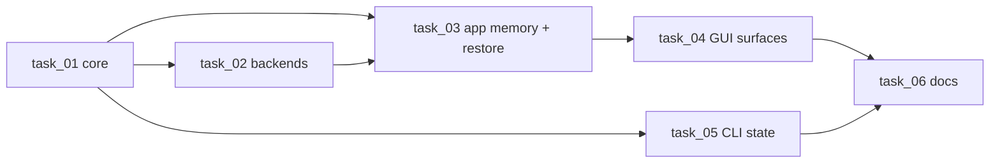

# Tasks: Remembered devices and startup look

Spec: [_spec.md](_spec.md) · Stories: [_user_stories.md](_user_stories.md) · Tests: [_tests.md](_tests.md) · DX: [_dx.md](_dx.md) · UI: [_uiux.md](_uiux.md)

| Task | Title | Type | Complexity | Depends on | Slice |
|------|-------|------|------------|------------|-------|
| [task_01](task_01.md) | Saved device state core | backend | medium | — | 1 (foundation for 02, 03, 05) |
| [task_02](task_02.md) | Backends save looks, toggle the light and restore | feature | high | task_01 | 1 (foundation for 03) |
| [task_03](task_03.md) | App remembers devices and restores them at startup | feature | high | task_01, task_02 | **1 — solves the Motivating Problem** |
| [task_04](task_04.md) | Sidebar shows remembered devices and their availability | frontend | medium | task_03 | 2 |
| [task_05](task_05.md) | CLI shows and restores the saved state | feature | medium | task_01 | 3 |
| [task_06](task_06.md) | Document remembered devices in both languages | docs | low | task_04, task_05 | 4 |

**Test ownership:** every `_tests.md` ID is assigned to exactly one task.

| Task | Tests |
|------|-------|
| task_01 | UT-001–UT-017, UT-020–UT-022 |
| task_02 | UT-040–UT-053, UT-060–UT-067 |
| task_03 | UT-030–UT-038, UT-090–UT-093, IT-001–IT-012 |
| task_04 | E2E-004–E2E-007 |
| task_05 | UT-070–UT-080, E2E-001–E2E-003 |
| task_06 | — (link/pair/Mermaid checks; owns the manual hardware checklist with the user) |
