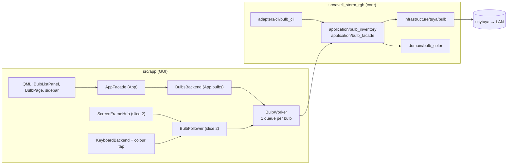

# Spec: Tuya smart bulbs

Status: Draft — awaiting user approval · Date: 2026-11-01 · Language: English (`.compozy/` artifacts are English-only by user decision)

Decisions come from the 2026-11-01 grilling session (12 questions, all answered with the recommended option except Q8, where the user chose selectable follow sources).

---

# Part I — Product

## Overview

- **Motivating Problem**: the three lights in the house (Quarto, Escritório, Sala) are Tuya bulbs controlled only by a separate script (`~/git/iot/bulbs.py`), outside the app that already owns the laptop's lights. Nothing in the app knows about them. Turning a light on, dimming it, or matching it to the keyboard means switching tools and typing room names in a terminal.
  **Simplest end-to-end outcome:** the user imports the `devices.json` written by the tinytuya wizard once, clicks **Connect** on the Escritório bulb in **Devices**, and from then on switches it on/off from the sidebar and sets brightness, white temperature or colour on its page, all without the cloud. `avell-storm-rgb bulb …` replaces `bulbs.py` in the terminal.
- **Who**: the owner of the Avell laptop, who also has Tuya bulbs at home. Secondarily, scripts and agents that use the CLI.
- **Why**: one app for every light around the desk, with the same "connect once, it's in the sidebar" model the user already knows. Later, the room light can follow the keyboard, the screen or the LED bar.
- **Transparent and optional**: without the optional `tuya` extra, or with no bulbs imported, the app looks and behaves exactly as today. With it, bulbs behave like the other devices: Devices → Connect → sidebar entry with a light switch → a page.

## Goals

- Import bulbs (name, id, local key, MAC) from the tinytuya wizard's `devices.json`, in the GUI and in the CLI.
- Connect, disconnect, forget and retry bulbs with the same flow as the USB devices, and remove a bulb (and its key) from the app.
- See each connected bulb's **real** state (on/off, mode, brightness, temperature, colour), refreshed while the window is visible.
- Switch a bulb on/off from the sidebar and its page; set brightness, white temperature and colour on its page.
- Control and inspect bulbs from the CLI (`bulb import|list|status|on|off|toggle|bright|white|color|remove`).
- **Slice 2:** per bulb, choose a follow source (None / Keyboard / Screen / LED bar). The bulb's colour then tracks it, the choice survives restarts, and following never switches a bulb on.
- Guarantee that opening the app (including at login) **never changes** a bulb, and that local keys are never displayed.

## User Stories

- US-001–US-005 — Bulb setup: import, connect, disconnect/forget, reconnect at startup, unavailable bulb.
- US-006–US-010 — Control: light switch, brightness, white temperature, colour, outside changes.
- US-011–US-012 — CLI: control and status, list/remove and `state show`.
- US-013–US-014 — Optional and private: no extra means no change; keys never displayed.
- US-015–US-018 — Follow (slice 2): keyboard, screen, LED bar, persistence and safety.

[Full user stories](_user_stories.md)

## Core Features

1. **Bulb inventory (import).** Reads a tinytuya `devices.json`, keeps the light entries that have a local key, and stores them in the app's own inventory file. Re-import updates names, keys and MACs by device id and never deletes. Remove deletes one entry.
2. **Bulb memory.** Connect remembers a bulb (sidebar entry + reconnect on start). Disconnect (or Forget, on an unavailable bulb) stops remembering it and keeps the key, as with the USB devices. Remove deletes the key. Startup reconnects remembered bulbs by **reading** their state only.
3. **Bulb control.** Light on/off, brightness, white temperature and colour. Explicit commands switch the bulb on, as the Tuya app and `bulbs.py` do.
4. **Live state.** The app shows what the bulb reports. A bulb changed from the phone or the wall switch shows the change at the next refresh.
5. **CLI.** The same capabilities for the terminal, plus `--json` for list/status/import. `state show` lists remembered bulbs.
6. **Follow (slice 2).** Per bulb: None, Keyboard (average of the colours the app sends to the keyboard), Screen (one screen capture shared with keyboard follow-screen), LED bar (static average of the LED bar palette).

Interaction: follow only runs on remembered, reachable bulbs. Disconnect, Forget and Remove stop it. The light switch and the page controls keep working while following (the next source change overwrites the colour).

## Business Rules

- **BR-1 Identity.** A bulb is identified by its Tuya device id. Names are labels: matching is case- and accent-insensitive (`escritorio` = `Escritório`), and two bulbs may share a name (the CLI then asks for the id).
- **BR-2 Import.** An entry is imported only if it has `id`, `key` and a light category (`dj`). Others are reported as skipped with a reason (`no local key`, `not a bulb (category cz)`, `missing category`). Re-import upserts by id and never removes entries.
- **BR-3 Keys are private.** Local keys live only in the inventory file (mode 0600). They never appear in `state.json`, logs, GUI text, CLI output (human or JSON) or error messages. Listings show `key: set`.
- **BR-4 Remember on success.** Connect remembers a bulb only after a status read succeeds. If the bulb is unreachable, it is not remembered and the error says so.
- **BR-5 Disconnect/Forget keep the key; Remove deletes it.** Disconnect (connected bulb) and Forget (unavailable bulb) set "not remembered" and stop following, like the USB devices. Remove (Devices row after confirmation; CLI `bulb remove`) deletes the inventory entry and the bulb's saved entry.
- **BR-6 Start never writes.** Startup, retry and periodic refresh only read bulb state. No command is sent to a bulb unless the user acts, or a follow source changes while the bulb is on.
- **BR-7 Real state.** A bulb's displayed state is its last successful status read or the result of the last command. Before the first read, the state is "unknown": the switch is disabled and the page says "Reading…".
- **BR-8 Refresh cadence.** Remembered bulbs are read at app start, when the window becomes visible, when a bulb page opens, and every 30 s while the window is visible. Nothing is polled while hidden in the tray, except that following bulbs are read every 5 s.
- **BR-9 Explicit commands switch on.** Brightness, white and colour commands from the GUI or CLI switch the bulb on.
- **BR-10 Ranges.** Brightness is 1–100 % (mapped to the device's detected `dpset['value_min']`–`value_max`, which is 10–1000 on the measured type-B bulbs). White temperature is 0–100 % (0 = warmest, 100 = coldest; device 0–1000). Colour is RGB 0–255 per channel, sent as HSV with V clamped to at least 1 %.
- **BR-11 Brightness follows the mode.** In white mode, brightness changes the white brightness. In colour mode, it changes the colour's V.
- **BR-12 Follow never switches on (slice 2).** Following writes only the mode and colour (never the power), and only while the bulb's last known power is on. Unknown power counts as off: no push until the first successful read. A bulb switched off by any means stays off.
- **BR-13 Follow rate (slice 2).** At most 4 colour updates per second per bulb, and only when the colour changed by at least 8 (0–255) in some channel. Only the latest colour is sent.
- **BR-14 Follow sources (slice 2).** Keyboard: the average colour of each solid/per-key/animation/follow-screen write the app sends to the keyboard. Firmware effects and a keyboard with its light off produce no colour, and the bulb keeps its colour. Screen: the average colour of the shared screen capture. LED bar: the static average of the applied LED bar palette; while the LED bar light is off, nothing changes.
- **BR-15 Follow persistence (slice 2).** The follow choice is saved per bulb and resumes when the app starts. Disconnect stops following but keeps the choice for a later Connect.
- **BR-16 One capture (slice 2).** At most one screen capture runs per app process, shared by the keyboard and every bulb following the screen. It stops when the last user stops.
- **BR-17 Optional.** Without the `tuya` extra, the GUI shows no bulb surface at all, and every `bulb` CLI verb prints how to install it.

## User Experience

- **Persona**: the laptop owner at the desk, already using the GUI for the keyboard and the LED bar.
- **First use**: Devices → "Smart bulbs" section → **Import Tuya devices…** → pick `devices.json` → three bulbs listed (online/offline) → **Connect** Escritório → it appears in the sidebar under "Enabled devices" with a light switch.
- **Daily use**: the sidebar switch turns the Escritório light on/off. Its page sets brightness, temperature or colour. At login the app shows the bulb's real state and never turns it on.
- **Terminal**: `avell-storm-rgb bulb off sala`, `avell-storm-rgb bulb status`.
- **Slice 2**: on the bulb page, **Follow: Keyboard** makes the room light match the keyboard while both are on.
- Screen-by-screen map: [UI change map](_uiux.md).

## High-Level Technical Constraints

- **Local only.** Control uses the Tuya LAN protocol (bulbs measured at protocol 3.3). There is no cloud call at run time; the cloud is only used once, outside the app, to produce `devices.json`.
- **Responsiveness.** A command opening a fresh connection takes 0.2–1.2 s (measured); the GUI must never block on it. Following uses a persistent connection (20–130 ms measured).
- **Other local clients.** Tuya bulbs usually accept one local connection. The app holds one only while a bulb follows a source.
- **Privacy.** BR-3.
- **Manageability.** Everything except following is operable from the CLI with `--json`. Following needs the running GUI.
- **Extensions.** None (this project has no extension ecosystem).

## Non-Goals (Out of Scope)

- Tuya cloud account inside the app (API key/secret). Rejected: the IoT Core trial expires and would add a stored secret (Q3).
- Bulb scenes (`scene_data_v2`) and music mode (Q7).
- Restoring a saved bulb look at start (Q5). The bulb is its own source of truth.
- System keyring storage (Q4).
- Always-on persistent connections (Q11).
- Following cycling the LED bar palette (Q9, A chosen: static average).
- Non-light Tuya devices (plugs, sensors).

## Open Questions

- **OQ-1 (hardware, slice 2):** does writing mode+colour (DPS 21/24) to a switched-off bulb turn it on with this firmware? BR-12 avoids it by gating on the last known power. The manual check changes a real house light, so it needs the user's go-ahead.
- **OQ-2 (UI):** the exact Breeze icon name for a bulb (`lightbulb` family), to be verified on the machine with a fallback icon.

---

# Part II — Technical

## Executive Summary

A new core slice adds Tuya bulbs next to the USB devices. It has a pure colour module, an inventory/import module, and a single infrastructure adapter, the only code that imports `tinytuya`, installed through the new optional `tuya` extra. The adapter resolves a bulb's IP (memory → ARP by MAC → last known IP → UDP discovery) and opens a connection per command, reusing the one open driver while a bulb follows a source. The CLI gets a `bulb` command group. In the GUI, a `BulbsBackend` exposed as `App.bulbs` runs every network call on a new `BulbWorker`, which has one serial session per bulb (one driver at a time) and never touches the USB thread. `AppFacade` stays the only writer of `state.json`, which gains an additive `devices.bulbs` map (remembered + follow, no look, no key).

Slice 2 adds `BulbFollower`. It coalesces colour events from three sources into at most 4 updates per second per bulb, over a persistent socket, writing only DPS 21/24. The sources are a colour tap on the keyboard driver, the LED bar's applied palette, and a new `ScreenFrameHub` that moves the follow-screen capture off the USB thread so the keyboard and bulbs share one capture. The main trade-offs: bulbs are read, never restored (ADR-002), and the follow-screen refactor fixes debt #6 for screen follow at the cost of touching a working feature (ADR-004).

## MVP Boundary

The MVP is slice 1: inventory + import, the driver adapter, CLI control, the `state.json` `bulbs` section, the GUI backend and worker, and the QML surfaces (Devices section, sidebar entries with switch, bulb page). It solves the Motivating Problem end to end. Slice 2 (post-MVP, same spec) adds follow: the keyboard tap, the LED bar source, `BulbFollower`, `ScreenFrameHub` and the follow selector. Everything in Non-Goals is out of scope.

## Developer Experience

- [Developer experience contract](_dx.md) — inventory file, `state.json` `bulbs` section, `bulb` CLI verbs, `state show` lines, `tuya` extra, errors.
- [UI change map](_uiux.md) — Devices "Smart bulbs" section, sidebar bulb entries, bulb page, follow selector.

## System Architecture



| Component | Responsibility | Boundary |
|-----------|----------------|----------|
| `domain/bulb_color.py` (new) | RGB average, RGB ↔ Tuya v2 HSV hex, % ↔ device ranges, "changed enough" | Pure; no I/O |
| `application/bulb_inventory.py` (new) | `BulbRecord`, inventory file load/save (0600, atomic), tinytuya import, target matching | No `tinytuya`, no Qt |
| `infrastructure/tuya/bulb.py` (new) | `TuyaBulb` adapter over `tinytuya.BulbDevice`; IP location (ARP, UDP discovery) | Only module importing `tinytuya` |
| `application/bulb_facade.py` (new) | `tuya_available()`, `open_bulb(record)` with IP resolution order and last-IP update | Returns `BulbDriver` (port) |
| `ports/protocols.py` (modified) | `BulbDriver` protocol (fakes in tests) | — |
| `application/device_state.py` (modified) | `BulbState`, `DeviceState.bulbs`, (de)serialisation | Qt-free; CLI reads, GUI writes |
| `adapters/cli/bulb_cli.py` (new) | `bulb` verbs; `main.py` registers the group; `state show` prints bulbs | No PySide6 |
| `app/core/bulb_worker.py` (new) | Per-bulb serial sessions (one driver each), `opDone`/`opFailed` | Network I/O only |
| `app/ui/adapters/bulbs_backend.py` + `bulb_model.py` (new) | QML contract, list model, row cache, refresh timer; applies `opDone` on the GUI thread | Submits to `BulbWorker` |
| `app/ui/adapters/bulb_follow.py` (new, slice 2) | Sources → coalesced pushes; persistent sockets | GUI-thread timers |
| `app/core/screen_hub.py` (new, slice 2) | One capture thread, ref-counted subscribers | Capture only; keyboard sink submits to `UsbWorker` |

## Architectural Boundaries

- `tinytuya` is imported **only** in `src/avell_storm_rgb/infrastructure/tuya/`, lazily, so `import avell_storm_rgb` and the CLI work without the extra.
- `domain/bulb_color.py` imports nothing from infrastructure (unlike debt #1).
- The core never imports PySide6. `app` depends on the core, never the reverse.
- Network I/O in the GUI goes **only** through `BulbWorker.submit(bulb_id, fn)`. Never on the GUI thread, never on the USB thread (`UsbWorker`).
- **One driver per bulb.** `BulbWorker` owns a per-bulb session. `submit` opens the driver lazily through `open_driver(bulb_id)` and closes it after the task, unless `set_hold_open(id, True)` was called (follow only). While held, every command and every `push_colour` for that bulb runs through the same `BulbDriver` on that bulb's queue; `close()` runs on follow→none, disconnect, forget, remove, unavailable and shutdown. Opening a second driver for a following bulb is a bug, not a fallback (B3).
- `state.json` stays single-writer (`AppFacade`, GUI thread). The inventory file is written by import/remove (CLI or GUI) and by the last-IP update, each an atomic read-modify-replace (ADR-001).
- Entry points: CLI `src/avell_storm_rgb/adapters/cli/main.py` (`main()`); GUI `src/app/main.py` (`AppFacade` constructed there).

## Implementation Design

### Core Interfaces

```python
# src/avell_storm_rgb/ports/protocols.py  (modified, additive)
class BulbDriver(Protocol):
    def status(self) -> "BulbStatus": ...                 # read only
    def set_power(self, on: bool) -> None: ...            # DPS 20
    def set_brightness(self, percent: int, status: "BulbStatus | None") -> None: ...
        # 1–100. White mode → DPS 22. Colour mode → DPS 24 with the hue/sat from status.rgb and V = percent (BR-11).
        # status None (caller has no snapshot) → read status() on the same connection first (one extra round trip).
        # Always switches on (BR-9).
    def set_white(self, temperature_percent: int | None, status: "BulbStatus | None") -> None: ...
        # DPS 21=white, 23. None → keep status.temperature; if that is unknown too, omit DPS 23
        # ({"20": True, "21": "white"}), which keeps whatever the bulb already has. Always switches on (BR-9).
    def set_colour(self, rgb: tuple[int, int, int]) -> None: ...  # DPS 21=colour, 24; switches on
    def push_colour(self, rgb: tuple[int, int, int]) -> None: ...  # follow only: DPS 21+24, never 20, nowait (BR-12)
    def hold_open(self, persistent: bool) -> None: ...    # persistent socket on/off (follow only)
    def close(self) -> None: ...
```

Status source for `set_brightness`/`set_white`: the GUI passes the row cache's last `BulbStatus` (no extra read, BR-7); the CLI passes the status it read for that bulb, or `None` when it has none, in which case the adapter reads once on the already-open connection. No verb opens a second connection for this.

```python
# src/avell_storm_rgb/application/bulb_inventory.py  (new)
@dataclass(frozen=True)
class BulbRecord:
    id: str            # Tuya device id (gwId)
    name: str
    key: str           # local key — never rendered (BR-3)
    mac: str           # lower-case aa:bb:cc:dd:ee:ff
    protocol: str = "3.3"
    last_ip: str | None = None

@dataclass(frozen=True)
class BulbStatus:
    on: bool
    mode: Literal["white", "colour", "scene", "music"]
    brightness: int          # percent 1–100 (current mode)
    temperature: int | None  # percent, white mode
    rgb: tuple[int, int, int] | None  # colour mode

@dataclass(frozen=True)
class BulbFailure:
    reason: str   # short user text, e.g. "not reachable", "local key or protocol rejected"
    detail: str   # "<ExceptionType>: <message>"; never a key or payload

def default_inventory_path() -> Path: ...  # $XDG_CONFIG_HOME/avell-storm-rgb/tuya_devices.json
class InventoryFileError(Exception): ...   # the inventory file exists but cannot be used
class ImportFileError(Exception): ...      # the wizard file is not a JSON list of devices (reason)
@dataclass(frozen=True)
class ImportResult:
    id: str
    name: str
    status: Literal["added", "updated", "unchanged"]
    reason: str | None = None   # e.g. "key changed" when status is "updated"
@dataclass(frozen=True)
class ImportReport:
    results: tuple[ImportResult, ...]   # .imported == len(results)
class BulbInventory:
    def __init__(self, path: Path | None = None) -> None: ...
    def load(self) -> list[BulbRecord]: ...            # missing → []; invalid → InventoryFileError
    def save(self, records: Sequence[BulbRecord]) -> None: ...  # 0600, tmp + os.replace
    def upsert(self, records: Sequence[BulbRecord]) -> "ImportReport": ...
    def remove(self, bulb_id: str) -> BulbRecord | None: ...
    def set_last_ip(self, bulb_id: str, ip: str) -> None: ...
def parse_tinytuya_devices(doc: Any) -> tuple[list[BulbRecord], list["Skipped"]]: ...
    # raises ImportFileError for a non-list document or invalid JSON text (UT-013)
def match_target(records: Sequence[BulbRecord], target: str) -> list[BulbRecord]: ...  # "all" | name | id

# src/avell_storm_rgb/application/bulb_facade.py  (new)
def tuya_available() -> bool: ...  # importlib.util.find_spec("tinytuya") is not None
def open_bulb(record: BulbRecord, inventory: BulbInventory, *, discover_timeout: float = 6.0) -> BulbDriver: ...
    # One fresh driver per call; the BulbWorker owns its lifetime (one per bulb, closed on release).
    # IP order: process cache → ARP (ip neigh) by MAC → record.last_ip → UDP discovery by id;
    # a different successful IP is written back with inventory.set_last_ip. Raises BulbUnreachable(name).

# src/avell_storm_rgb/application/device_state.py  (modified, additive)
Follow = Literal["none", "keyboard", "screen", "led_bar"]
@dataclass(frozen=True)
class BulbState:
    id: str
    remembered: bool = True
    follow: Follow = "none"
@dataclass(frozen=True)
class DeviceState:
    keyboard: KeyboardState | None = None
    led_bar: LedBarState | None = None
    bulbs: tuple[BulbState, ...] = ()   # sorted by id
```

```python
# src/app/core/bulb_worker.py  (new)
class BulbWorker(QObject):
    opDone = Signal(str, object)           # (bulb_id, BulbStatus | BulbFailure) — delivered on the GUI thread
    opFailed = Signal(str)                 # user-facing text only: "{name}: {message}" (never the key)
    def __init__(self, open_driver: Callable[[str], BulbDriver], parent=None) -> None: ...
    def submit(self, bulb_id: str, fn: Callable[[BulbDriver], Any]) -> None: ...
        # FIFO per bulb; different bulbs run in parallel; fn receives that bulb's current session driver.
    def set_hold_open(self, bulb_id: str, hold: bool) -> None: ...  # follow only; queued hold_open(hold)/close()
    def shutdown(self, wait: bool = False) -> None: ...             # closes every open session

# src/app/ui/adapters/bulbs_backend.py  (new) — exposed as App.bulbs
class BulbsBackend(QObject):
    modelChanged = Signal(); bulbEpochChanged = Signal(); importSummaryChanged = Signal()
    persistUpdate = Signal(str, object)    # (bulb_id, {"remembered": bool} | {"follow": str} | {"remove": True}) → AppFacade
    model: BulbListModel                   # Property(QObject, constant)
    bulbEpoch: int                         # Property, bumps on any bulb state change
    importSummary: str                     # Property, last import result line
    windowVisible: bool                    # Property; AppFacade.setWindowVisible() keeps it current (BR-8)
    @Slot("QUrl") importFile(file_url)     # FileDialog.selectedFile; toLocalFile() before any Path use
    @Slot(str) connectBulb(bulb_id); disconnectBulb(bulb_id); forgetBulb(bulb_id); retryBulb(bulb_id); removeBulb(bulb_id)
    @Slot() refresh()                      # reads remembered bulbs (BR-8)
    @Slot(str, bool) setLightOn(bulb_id, on)
    @Slot(str, int) setBrightness(bulb_id, percent); setWhite(bulb_id, temperature_percent)
    @Slot(str, int, int, int) setColor(bulb_id, r, g, b)
    @Slot(str, str) setFollow(bulb_id, source)          # slice 2
    @Slot(str, result=list) availableFollowSources(bulb_id)  # slice 2: subset of keyboard/screen/led_bar the runtime supports
    @Slot(str, result="QVariantMap") bulb(bulb_id)      # snapshot for BulbPage, re-read on bulbEpoch
    # Private _on_op_done(bulb_id, result): the only place a worker result reaches the row cache.
```

`BulbsBackend` is the **only** consumer of `BulbWorker.opDone` and it runs on the GUI thread: it applies the result to that id's row cache, bumps `bulbEpoch`, and emits `modelChanged`. The worker never touches the model or a row object; `opFailed` carries text only, and the backend calls `AppState.reportError` with it.

```python
# src/app/ui/adapters/app_facade.py  (modified, additive)
@Property(bool, constant=True) bulbsAvailable  # tuya_available()
@Property(QObject, constant=True) bulbs        # BulbsBackend (inert when not available)
# restoreRememberedDevices(): after LED bar and keyboard, bulbs.refresh() (reads only, BR-6)
# refreshDevices() (Devices footer Refresh): also bulbs.refresh()
# _on_bulb_persist(id, changes): only writer of devices.bulbs in state.json
@Slot(bool) setWindowVisible(visible)          # bound from main.qml Window.visible / closeToTray; drives BR-8

# Slice 2
# src/app/ui/adapters/keyboard_backend.py — the driver is wrapped at connect time:
class _ColourTap:  # forwards every attribute to the real driver
    def set_key_colors(self, color_map=None, **kw): ...  # after success: on_colour(average_rgb(color_map.values()))
    def set_color(self, color, *a, **kw): ...            # after success: on_colour(color)
KeyboardBackend.colorsSent = Signal(int, int, int)       # emitted from the USB thread → queued

# src/app/core/screen_hub.py
class ScreenFrameHub(QObject):
    frame = Signal(object)            # PIL RGB image, latest only
    def subscribe(self, owner: object) -> None: ...    # first subscriber starts capture (portal picker on Wayland)
    def unsubscribe(self, owner: object) -> None: ...  # last one stops it
# src/avell_storm_rgb/application/screen_follow*.py: capture split from apply —
def iter_screen_frames(stop: threading.Event, **region) -> Iterator["Image"]: ...  # X11 or Wayland

# src/app/ui/adapters/bulb_follow.py
class BulbFollower(QObject):
    def set_source(self, bulb_id: str, source: Follow) -> None: ...
    # 250 ms QTimer per following bulb: send latest colour if changed ≥ 8 and last power on (BR-12, BR-13)
```

### Data Models

**Inventory file** `tuya_devices.json` (new, mode 0600):

| Field | Type | Purpose |
|-------|------|---------|
| `version` | int = 1 | Schema version |
| `devices[].id` | str | Tuya device id (identity, BR-1) |
| `devices[].name` | str | Display/CLI name |
| `devices[].key` | str | Local key (BR-3) |
| `devices[].mac` | str | ARP lookup |
| `devices[].protocol` | str | Tuya LAN version (`"3.3"`); from import or discovery, default `"3.3"` |
| `devices[].last_ip` | str \| null | Last IP that answered; speeds up the CLI |

Representation: one small JSON file next to `state.json`. It is not inside `state.json` because it holds secrets and has different writers (ADR-001).

**`state.json`** (modified, additive, still `version: 1`): `devices.bulbs` is an object keyed by Tuya id, with `{"remembered": bool, "follow": "none"|"keyboard"|"screen"|"led_bar"}`. Unknown follow values fail validation like any other field. Entries whose id is missing from the inventory are ignored by the GUI and dropped on its next write, **but only when the `tuya` extra is importable and the inventory loaded successfully**; if the extra is absent, or the inventory is missing/corrupt/unreadable, every entry is kept as-is and rewritten unchanged (M5, US-013.EC-2).

**`BulbListModel` roles and `bulb(id)` snapshot.** The model rows and the `bulb(id)` map use the same keys; QML binds to them directly.

| Key | Type | Meaning |
|-----|------|---------|
| `bulbId` | str | Tuya device id |
| `title` | str | Bulb name |
| `subtitle` | str | S1 row line: `online · <ip>` / `offline` / `Reading…` |
| `remembered` | bool | Saved with `remembered: true` |
| `available` | bool | The last operation reached the bulb |
| `lightOn` | bool | Last known power; meaningful only when `stateKnown` |
| `stateKnown` | bool | At least one status read or command result exists |
| `unavailableReason` | str | `""` when available; the `_dx.md` reason otherwise |
| `mode` | str | `white` / `colour` / `scene` / `music` / `unknown` |
| `brightness` | int | 0 when unknown |
| `temperature` | int | `-1` when unknown or not white |
| `rgb` | list[int] | `[r, g, b]`; empty when unknown or not colour |
| `follow` | str | `none` / `keyboard` / `screen` / `led_bar` |
| `ip` | str | Last known IP; `""` when unknown |
| `busy` | bool | Connect/Retry in flight for this row |

QML must not read a key that is not in this table. Adding one updates `_uiux.md` and `_tests.md` in the same change.

### QML ↔ Python surface (replaces "API Endpoints")

The interfaces above are the whole contract. QML reads `App.bulbsAvailable`, `App.bulbs.model` (roles above), `App.bulbs.bulbEpoch`, `App.bulbs.windowVisible` and `App.bulbs.bulb(id)` (snapshot keys above), and calls the `App.bulbs.*` slots. Results reach the model only through `BulbWorker.opDone` → `BulbsBackend` on the GUI thread; user-facing errors use `BulbWorker.opFailed` → `AppState.reportError`, which sets `App.state.lastError`. Bulb operations never set `App.state.busy`.

`main.qml` reports window visibility with `App.setWindowVisible(visible)` (on `Window.visibleChanged`, including hides through `closeToTray`), which forwards to `App.bulbs.windowVisible` and stops/starts the 30 s refresh (BR-8, M7).

## Integration Points

- **Tuya LAN protocol** via `tinytuya>=1.20,<2`: TCP 6668 per command; UDP 6666/6667 broadcasts for discovery. Auth = per-device local key. Timeout 5 s per command. No retries for commands (except the 914 protocol retry below). A failed read marks the bulb unavailable until the next refresh/retry.
- **tinytuya returns, it does not raise.** Every device call (`status`, `set_power`, `set_brightness`, `set_white`, `set_colour`, `push_colour`, `set_multiple_values`) returns a dict; the adapter inspects `Err` after each call and raises the mapped error. `Err` 914 → `KeyRejected`; 901, 902, 905 and a timeout → `BulbUnreachable`; anything else → `BulbError`. `Error` and `Payload` never reach a message — only the exception type and a fixed phrase — so a payload cannot leak a key (M2, US-014.EC-1).
- **914 means "local key or protocol".** tinytuya reports 914 both for a wrong key and for a wrong protocol version, and two of the three real bulbs import with `version: ""` (stored as the `3.3` default). On 914 the adapter runs **one** UDP discovery for that id; if it reports a version different from the stored one, it retries the call once with it. If the retry fails, or discovery reports the same/unknown version, it raises `KeyRejected("local key or protocol rejected")`. The user-facing text is "local key or protocol rejected — re-import devices.json" (M2).
- **ARP table** via `ip neigh` (iproute2): MAC → IP, read-only.
- **xdg-desktop-portal / PipeWire or X11** (slice 2): unchanged capture code, now driven by `ScreenFrameHub`.

## Impact Analysis

| Component | Impact | Description and Risk | Required Action |
|-----------|--------|----------------------|-----------------|
| `pyproject.toml`, `uv.lock` | modified | New extra `tuya = ["tinytuya>=1.20,<2"]`. Low | `uv add --optional tuya "tinytuya>=1.20,<2"` |
| `state.json` (persisted user state) | modified, additive | `devices.bulbs` added, version stays 1. Older builds ignore it and drop it when they rewrite the file. Low (single user, older builds superseded) | Document in DEVELOPMENT; no migration needed |
| `tuya_devices.json` (persisted user state) | new | Secrets file, 0600 | — |
| CLI (public surface) | additive | `bulb` group; `state show` adds `bulb` lines and `devices.bulbs` in JSON. `state restore` unchanged | `test_cli_help`, `test_cli_state` updates |
| `AppFacade`, `main.qml`, `DevicesPage.qml` | modified | New property/children and `setWindowVisible`; sidebar rebuild includes bulbs; StackLayout gets `BulbPage` at index 5 (existing indices unchanged); the sidebar light switch becomes model-driven (six `main.qml` edits in `_uiux.md` S4). Medium (shell tests) | Keep existing `objectName`s |
| `KeyboardBackend` (slice 2) | modified | Driver wrapped by `_ColourTap`; follow-screen uses `ScreenFrameHub`. Medium (working feature) | Characterisation tests before refactor |
| `screen_follow*.py` (slice 2) | modified | Capture split from apply; the CLI `follow-screen` keeps its behaviour through a thin loop | `test_screen_follow_frame` + new cases |
| Docs | modified | README, DEVELOPMENT, OVERVIEW, ARCHITECTURE, FLOWS, FEATURE_MATRIX, GLOSSARY, DEVICE_FEATURES_DEEP_DIVE, both languages; root and `src/app` AGENTS.md rules | Task-owned |
| `~/git/iot/bulbs.py` | none | Outside the repo; superseded by the CLI, not deleted | — |

No delete targets.

## Extensibility Integration Plan

Not applicable. The project has no extension manifests, hooks or plugin registries (checked: `pyproject.toml` entry points list only the two scripts).

## Agent Manageability Plan

Agents use the CLI: `bulb list --json`, `bulb status --json`, `bulb import --json`, the control verbs (exit codes in `_dx.md`), and `state show --json` for remembered/follow. Following needs the running GUI and has no CLI verb (decision Q12).

## Config Lifecycle

No `config.toml` exists in this project. QSettings keys are unchanged. Persistent state is covered in Data Models.

## Testing Approach

- pytest in `tests/`. Fakes sit at I/O boundaries: a `FakeBulb` implementing `BulbDriver` (journal of calls, programmable status/failures), fake ARP/discovery functions, and the existing `FakeKeyboard`/`FakeLedBar`.
- Unit: colour math, import parsing, inventory store (0600, atomic, upsert), target matching, IP resolution order, `state.json` bulbs round-trip, `TuyaBulb` payloads and error-dict mapping against a stub `tinytuya.BulbDevice` (`pytest.importorskip("tinytuya")`), `BulbWorker` isolation and session reuse, backend slots, follower coalescing, colour tap, hub ref-counting.
- Integration: `AppFacade` + `BulbsBackend` + `BulbWorker` + real `DeviceStateStore` in `tmp_path`.
- E2E: CLI transcripts from `_dx.md` through `main(argv)` with a fake `open_bulb`. Offscreen GUI journeys via `tests/gui_helpers.py`.
- Manual hardware checklist (real bulbs, needs the user's go-ahead because it changes house lights).

Details: [`_tests.md`](_tests.md).

## Development Sequencing

### Build Order

1. Core: `bulb_color`, `bulb_inventory`, `BulbDriver` port, `tuya/bulb.py`, `bulb_facade`, `tuya` extra. Gate: unit tests.
2. CLI `bulb` group. Gate: `_dx.md` transcripts. *(Already replaces `bulbs.py`.)*
3. `state.json` `bulbs` + `state show`. Gate: round-trip and CLI tests.
4. GUI backend: `BulbWorker`, `BulbListModel`, `BulbsBackend`, `AppFacade` wiring, refresh timer. Gate: integration tests. Depends on 1, 3.
5. QML: Devices section + import dialog, sidebar entries + switch, `BulbPage`. Gate: offscreen GUI tests. Depends on 4. **End of slice 1 (MVP).**
6. Slice 2 — follow core: `_ColourTap`, LED bar source, `BulbFollower`, persistent sockets, follow selector, persistence. Depends on 5.
7. Slice 2 — `ScreenFrameHub` + split capture; Screen source. Depends on 6. Characterisation tests first.
8. Docs (bilingual) + manual hardware checklist. Can follow 5 for slice 1 and 7 for slice 2.

### Technical Dependencies

- `tinytuya` from PyPI (pure Python; pulls `cryptography`, `requests`, `colorama`).
- Bulbs reachable on the LAN. UDP 6666/6667 must not be firewalled for discovery (ARP and the last IP still work without it).

## Monitoring and Observability

- Logger `avell_storm_rgb.gui` (existing). Bulb op failures: `ERROR bulb <name> (<id>): <ExceptionType>: <message>`. Discovery result at DEBUG: `bulb <name> at <ip> protocol <v> via <arp|last_ip|discovery>`.
- The `tinytuya` logger is pinned to WARNING **immediately after** the lazy import (`logging.getLogger("tinytuya").setLevel(logging.WARNING)`), whatever `--debug` does to app loggers. `tinytuya.set_debug()` is never called: it runs `logging.basicConfig(level=DEBUG)` and raises the parent logger, and tinytuya logs the local key in clear at DEBUG (`core/XenonDevice.py:1085`). A test forces the tinytuya logger to DEBUG and asserts the pin holds (M3, UT-071).
- No metrics or alerts (desktop app).

## Technical Considerations

### Key Decisions

- **KD-1** tinytuya as optional extra; import-only onboarding; inventory file 0600 → [ADR-001](adrs/adr-001.md).
- **KD-2** Bulbs are read, not restored; follow never switches on → [ADR-002](adrs/adr-002.md).
- **KD-3** Per-bulb serial queues, on-demand connections, persistent only while following, coalesced pushes → [ADR-003](adrs/adr-003.md).
- **KD-4** One shared screen capture; follow-screen capture leaves the USB thread → [ADR-004](adrs/adr-004.md).
- **KD-5** The keyboard source taps the driver object instead of each call site. Every solid/per-key/animation/follow-screen write passes through `set_color` or `set_key_colors` (`keyboard_backend.py:1218`, `:1327`, `screen_follow_frame.py:25-34`), so one wrapper covers them all. Rejected: emitting from each slot, which is easy to miss in new code.
- **KD-6** `push_colour` writes DPS directly (`set_multiple_values({"21": "colour", "24": hex})`; it waits for the echo since hardware check M-6 — unread echoes polluted the persistent socket). tinytuya 1.20's `set_colour` adds `switch: True` (BulbDevice `check_values`), which would break BR-12.

### Known Risks

- **Follow write turns a bulb on (OQ-1)**: medium likelihood, firmware-dependent. Mitigation: gate on last power, 5 s reads while following, manual check.
- **Single local connection**: while a bulb follows, `bulbs.py` or other LAN clients may fail on that bulb. Opt-in; documented.
- **Discovery blocked by a firewall**: ARP + last IP fallback; the error text names UDP 6666/6667.
- **Follow-screen regression (slice 2)**: characterisation tests on the keyboard writes plus a manual X11/Wayland check before and after.
- **Flicker**: ≤ 4 Hz and the change threshold. Tuya bulbs fade by themselves.

## Safety Invariants

1. A local key exists only in the inventory file (0600) and in memory inside `TuyaBulb`. No `str()`, log line, signal payload, model role or CLI output contains it.
2. Network I/O never runs on the GUI thread or the USB thread. Commands for one bulb run in submission order. Worker results reach the model only through `opDone` on the GUI thread.
3. Startup, retry and refresh call only `BulbDriver.status()`.
4. `push_colour` never writes DPS 20 and is never called while that bulb's last known power is off.
5. `state.json` has one writer (`AppFacade`, GUI thread). The CLI never writes `state.json`. Inventory writes are atomic replaces.
6. A persistent bulb socket exists only while that bulb follows a source. It closes on follow → none, disconnect, forget, remove, unavailable, and app shutdown.
7. At most one screen capture session runs per process. It stops when the last subscriber unsubscribes.
8. No bulb operation emits `UsbWorker.opStarted` or sets `AppState.busy`.
9. At most one `BulbDriver` exists per bulb. While it is held open (follow), every command for that bulb reuses it; no second driver is opened.

## File References

### Repo Files

- `AGENTS.md`, `src/app/AGENTS.md`, `src/app/ui/AGENTS.md` — threading, single-writer and QML rules this design extends.
- `docs/ARCHITECTURE.md` — layers, threading model, state table, known debts #1, #6.
- `src/avell_storm_rgb/application/device_state.py:35-110,235-370` — state model, (de)serialisation, store and path to extend with `BulbState`.
- `src/avell_storm_rgb/ports/protocols.py` — where `BulbDriver` joins the existing driver protocols.
- `src/avell_storm_rgb/adapters/cli/main.py:300-420,448-530` — `state show` printer, exit-code conventions, subparser registration.
- `src/app/core/usb_worker.py:16-48` — worker pattern `BulbWorker` mirrors (signals, executor, shutdown).
- `src/app/ui/adapters/app_facade.py:76-117,196-235,342-415,536` — backend wiring, remember/forget/retry, startup restore order, and the `_on_persist` single-writer path to extend.
- `src/app/ui/adapters/device_model.py` — list-model pattern for `BulbListModel`.
- `src/app/ui/adapters/led_bar_backend.py:24,93,159-176` — `persistUpdate` with the applied look: the LED bar follow source.
- `src/app/ui/adapters/keyboard_backend.py:973-1016,1218,1310-1335,1357-1370` — driver open/close (tap point), solid colour, animation loop, follow-screen task.
- `src/avell_storm_rgb/application/screen_follow_dispatch.py:32-56`, `screen_follow.py:12-60`, `screen_follow_wayland.py:24-90`, `screen_follow_frame.py:13-34` — capture loops to split.
- `src/app/ui/main.qml:60-70,107-110,115-121,282,309-318,327-348,584-604` — sidebar index sync, forgotten-page reset, `unavailableReasonForPage`, sidebar model rebuild, unavailable subtitle, light switch, content stack.
- `src/app/ui/pages/DevicesPage.qml:23-48`, `src/app/ui/components/DeviceListPanel.qml:19,152-154,161-176` — Connect/Disconnect row pattern and the existing "Remembered — configure it from the sidebar." copy.
- `tests/backend_fakes.py`, `tests/gui_helpers.py`, `tests/conftest.py` — fakes, offscreen QML harness, `XDG_CONFIG_HOME` isolation.
- `.compozy/tasks/remembered-devices/_spec.md`, `_dx.md` — remembered-device semantics and CLI conventions reused here.

### External References

- `~/git/iot/bulbs.py` — the script being replaced (outside this repo): name matching, ARP lookup, brightness mapping.
- `~/git/iot/.venv/lib/python3.13/site-packages/tinytuya/BulbDevice.py:393-418` and the `set_colour`/`set_white` `check_values` with `'switch': True` — why `push_colour` writes DPS directly (KD-6). External, not vendored.

## Assumptions and Defaults

- Protocol default `3.3` when import/discovery gives none. Command timeout 5 s. Discovery timeout 6 s. The 914 retry runs one discovery and only retries when the discovered version differs from the stored one.
- Brightness and white ranges come from the detected `dpset` (`value_min`/`value_max`); when no `dpset` is available, type B (10–1000) is assumed. All three measured bulbs are type B; a type-A `dj` bulb is outside the measured set (M8).
- Refresh 30 s (visible window), 5 s for following bulbs. Follow tick 250 ms. Change threshold 8.
- Sync colour = source RGB as-is, V clamped to ≥ 1 %. A dark screen dims the bulb, as ambient lighting should.
- Category filter `dj` (all three bulbs). Other light categories can be added when a device needs them.
- Sidebar order: Devices, Keyboard, LED bar, then bulbs by name.

## Architecture Decision Records

- [ADR-001: tinytuya extra, imported keys, private inventory file](adrs/adr-001.md) — local-only control, no cloud account, keys out of `state.json`.
- [ADR-002: Bulbs are read, not restored](adrs/adr-002.md) — the device is the source of truth; startup never writes; follow never switches on.
- [ADR-003: Bulb network I/O model](adrs/adr-003.md) — per-bulb queues, on-demand connections, persistent only while following.
- [ADR-004: One shared screen capture](adrs/adr-004.md) — `ScreenFrameHub` feeds the keyboard and bulbs; capture leaves the USB thread.
