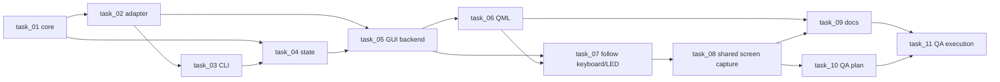

# Tasks: Tuya smart bulbs

Spec: [_spec.md](_spec.md) · Stories: [_user_stories.md](_user_stories.md) · Tests: [_tests.md](_tests.md) · DX: [_dx.md](_dx.md) · UI: [_uiux.md](_uiux.md) · Review: [_review.md](_review.md)

| Task | Title | Type | Complexity | Depends on | Slice |
|------|-------|------|------------|------------|-------|
| [task_01](task_01.md) | Bulb colour, inventory and driver port | backend | medium | — | 1 (foundation for 02, 03, 04) |
| [task_02](task_02.md) | Tuya LAN adapter and bulb opener | backend | high | task_01 | 1 (foundation for 03, 05) |
| [task_03](task_03.md) | Terminal control with the `bulb` command group | feature | high | task_02 | **1 — first useful solution (terminal)** |
| [task_04](task_04.md) | Saved bulb state and `state show` | backend | medium | task_01, task_03 | 1 (foundation for 05) |
| [task_05](task_05.md) | GUI bulb backend, worker and startup refresh | feature | high | task_02, task_04 | 1 (foundation for 06, 07) |
| [task_06](task_06.md) | Bulb surfaces in Devices, the sidebar and a page | frontend | high | task_05 | **1 — completes the Motivating Problem (GUI) · end of MVP** |
| [task_07](task_07.md) | Follow the keyboard and the LED bar | feature | high | task_05, task_06 | 2 |
| [task_08](task_08.md) | Screen follow over one shared capture | feature | high | task_07 | 2 |
| [task_09](task_09.md) | Document Tuya bulbs in both languages | docs | low | task_06, task_08 | delivery |
| [task_10](task_10.md) | Plan the delivery QA for bulbs | qa-report | low | task_08 | delivery |
| [task_11](task_11.md) | Execute the delivery QA for bulbs | qa-execution | medium | task_09, task_10 | delivery |

## Why this order

- **task_01–task_02** establish the shared contracts (`BulbDriver`, inventory, colour math, error mapping) that every consumer fakes or calls.
- **task_03** is the earliest end-to-end solution to the Motivating Problem: the terminal path replaces `bulbs.py` before any GUI work.
- **task_04** adds the persisted `devices.bulbs` section that the GUI needs, and extends `state show` for agents.
- **task_05–task_06** complete the Motivating Problem in the app: Connect once, sidebar switch, bulb page. task_06 ends slice 1 (MVP).
- **task_07–task_08** are slice 2. task_07 resolves the follower/colour-tap contract; task_08 moves the screen capture behind the shared hub last, because it refactors a working feature (ADR-004).
- **task_09–task_11** document, plan and execute the delivery QA. The QA planning evidence already lives in `_tests.md` (coverage matrix + manual checklist), so task_10 turns it into an executable plan once, and task_11 executes it once.

## Test ownership

Every `_tests.md` ID is assigned to exactly one task. The manual hardware checklist (`M-1`–`M-7`) is not a test ID; task_11 owns its execution.

| Task | Tests |
|------|-------|
| task_01 | UT-001–UT-006, UT-010–UT-019, UT-070 |
| task_02 | UT-020–UT-028, UT-030–UT-033, UT-072, UT-073 |
| task_03 | E2E-001–E2E-012, E2E-014, E2E-015 |
| task_04 | UT-034, UT-036, UT-038, UT-039, E2E-013, E2E-016 |
| task_05 | UT-035, UT-037, UT-040–UT-057, UT-060–UT-064, IT-001–IT-006 |
| task_06 | E2E-020–E2E-026, E2E-028 |
| task_07 | UT-080–UT-089, UT-095–UT-098, UT-101, IT-010, IT-012, IT-013, IT-015, E2E-027 |
| task_08 | UT-090–UT-094, UT-099, UT-100, IT-011, IT-014 |
| task_09 | — (bilingual pair, link and Mermaid checks) |
| task_10 | — (QA plan; no new cases) |
| task_11 | UT-071 (cross-surface privacy audit), M-1–M-7 (manual hardware checklist) |

Counts: 84 UT + 12 IT + 25 E2E = 121 IDs, all assigned once.
