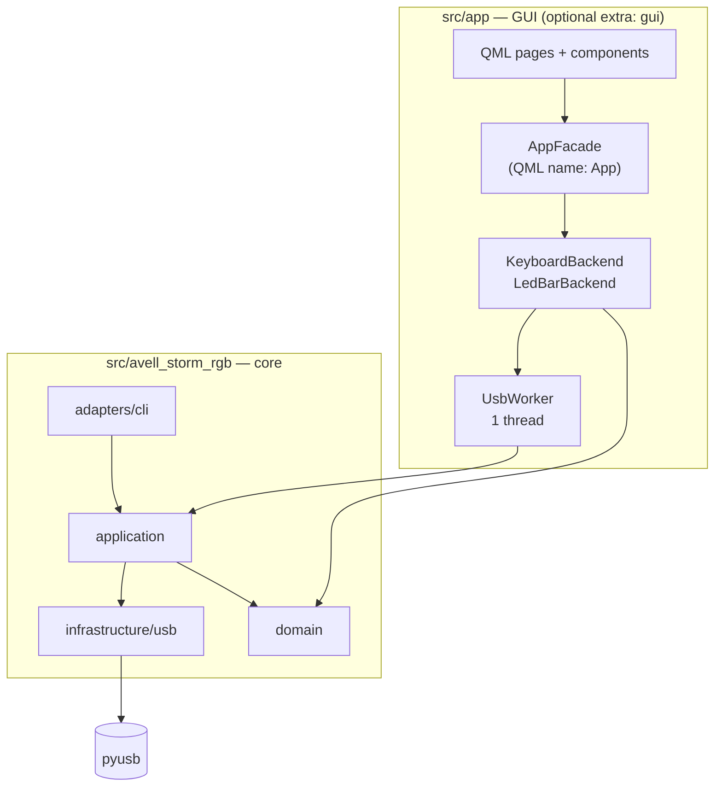
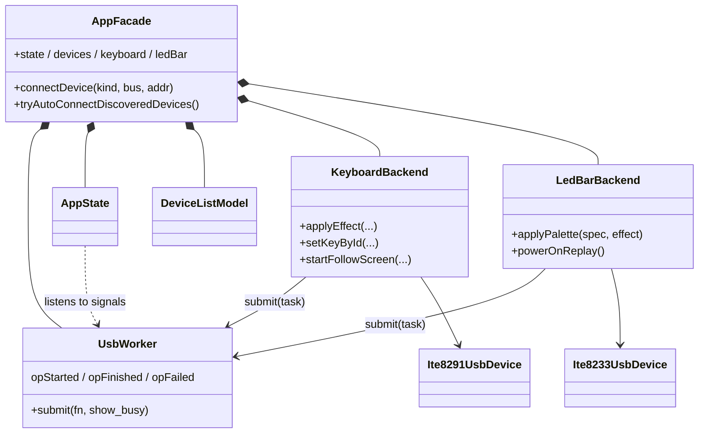

🇺🇸 English · [🇧🇷 Português](ARCHITECTURE.pt-BR.md)

# Architecture

⏱️ **Reading time:** ~8 min

> **TL;DR**
> - Two packages under `src/`: **`avell_storm_rgb`** (core + CLI, layered) and **`app`** (PySide6/QML GUI). **`app` depends on the core, never the reverse.**
> - In the GUI, **all USB I/O runs on one background thread** (`UsbWorker`). QML never touches USB.
> - The **wire protocol lives only in `infrastructure/usb/`**. Do not change bytes without hardware proof.

**Read this if…** you are about to change code and need to know where things live and why.

---

## 🏗️ Big picture

| Entry point | Script (`pyproject.toml`) | Function |
|-------------|---------------------------|----------|
| CLI | `avell-storm-rgb` | `src/avell_storm_rgb/adapters/cli/main.py:415` `main()` |
| GUI | `avell-storm-rgb-gui` | `src/app/main.py:19` `main()` |

## 🏗️ Core package — `src/avell_storm_rgb/`

| Layer | Folder | Holds | Key files |
|-------|--------|-------|-----------|
| **domain** | `domain/` | Pure logic, no USB: animation DSL, colour/palette parsing, per-key layout, UI ↔ device row mapping | `anim_dsl.py`, `ledbar_colors.py`, `per_key_grid.py`, `keyboard_solid_colors.py` |
| **ports** | `ports/` | `Protocol` types for drivers (test fakes) | `protocols.py` |
| **application** | `application/` | Use cases: open/describe devices, follow-screen (X11, Wayland, dispatch, frame sampling) | `device_facade.py`, `screen_follow*.py` |
| **infrastructure** | `infrastructure/usb/` | **Wire-accurate** drivers, effect tables, discovery | `ite8291_usb.py`, `ite8233_usb.py`, `discovery.py` |
| **adapters** | `adapters/cli/` | `argparse`; one `_cmd_*` handler per subcommand | `main.py` |

**Intended dependency rule:** `adapters → application → domain / infrastructure`, and **domain stays pure**.

> [!WARNING]
> The real code bends this rule in a few places. See **Known debts** at the end of this page.

## 🏗️ GUI package — `src/app/`

| Path | Role |
|------|------|
| `main.py` | Bootstrap: logging → Qt Quick Controls style → `QApplication` → `QQmlApplicationEngine` → `AppFacade` as `App` → load `ui/main.qml` → tray |
| `qml_paths.py` | Adds system Qt6 QML paths (Kirigami); picks style `org.kde.desktop` (Breeze) or `Fusion` |
| `tray.py` | `TrayController`: show / hide / quit from the system tray |
| `logutil.py` | Stderr logging; `--verbose` / `--debug` / `AVELL_STORM_RGB_LOG` |
| `core/usb_worker.py` | `UsbWorker`: single-thread task queue |
| `core/devices.py` | USB enumeration as dicts; `open_led_bar_at(bus, addr)` |
| `ui/adapters/` | `QObject`s exposed to QML: `AppFacade`, `AppState`, `DeviceListModel`, `KeyboardBackend`, `LedBarBackend` |
| `ui/main.qml` | Shell: sidebar, sub-navigation, content `StackLayout`, busy overlay |
| `ui/pages/` | `DevicesPage`, `KeyboardPage`, `LedBarPage`, `SettingsPage`, `AppAboutPage` |
| `ui/components/` | Reusable QML: `KeyboardLayoutView`, `ColorWell`, `EffectCard`, `SliderSpinRow`, `DeviceListPanel`, `BusyOverlay`, … |

**QML ↔ Python contract:** QML only sees the `App` context property (`src/app/ui/adapters/app_facade.py:37`). Everything is `Property` (read), `Slot` (call) or `Signal` (notify). Examples: `App.keyboard.applyEffect(...)`, `App.ledBar.connected`, `App.state.busy`.

## 🏗️ Threading model

| Thread | Runs | Rule |
|--------|------|------|
| **GUI thread** | Qt event loop, QML, property reads, debounce timers | Never blocks on USB |
| **USB thread** (`usb`) | `ThreadPoolExecutor(max_workers=1)` — `src/app/core/usb_worker.py:16` | Every USB call goes here, **one at a time, FIFO** |

**The pattern every backend slot follows:**

1. The slot validates or clamps its inputs and updates session state on the GUI thread.
2. It wraps the USB work in a local `def task(): ...`.
3. It calls `self._worker.submit(task)`.
4. Results come back through **signals** (several use `Qt.QueuedConnection` explicitly).

**Busy and errors:**

- `submit(show_busy=True)` → `opStarted` → `AppState.busy` → the overlay shows.
- An exception inside a task → `opFailed(msg)` → `AppState.lastError` → shown in the UI and logged to stderr.

> [!WARNING]
> **One USB thread means long tasks block the queue.** While follow-screen or a looping animation runs, every other USB command waits behind it (brightness, effects, **even the LED bar**). They are stopped through a shared `threading.Event` (`_follow_stop`) set by **Stop**.

The **CLI has no threads**: each command opens the device, runs, and exits. `Ctrl+C` ends loops.

## 🏗️ State and persistence

| What | Where it lives | Survives restart? |
|------|----------------|-------------------|
| Close to tray, auto-connect | `QSettings` keys `ui/closeToTray`, `ui/autoConnectOnStartup` | ✅ |
| Keyboard palette colours (for display) | `KeyboardBackend._palette_mirror` (session mirror) | ❌ |
| Per-key colours (UI coordinates) | `KeyboardBackend._key_colors` | ❌ |
| Last firmware effect params (to re-apply on brightness change) | `KeyboardBackend._last_fw_*` | ❌ |
| Keyboard effect before power off | `KeyboardBackend._last_effect_snapshot` | ❌ |
| LED bar last mode (for power-on replay) | `LedBarBackend._last_replay` | ❌ |
| LED bar brightness / speed / palette | Attributes on `Ite8233UsbDevice`; sent with the next effect | ❌ |
| Effect inside the keyboard | Controller memory; `save=1` asks it to persist | Hardware-dependent |

> [!NOTE]
> The devices are **barely readable**. Only the keyboard reports FW version, current effect bytes, brightness and on/off. Everything else the GUI shows comes from mirrors of what **this session** sent.

## 🏗️ Device protocol in one screen

**Keyboard — ITE 8291** (`src/avell_storm_rgb/infrastructure/usb/ite8291_usb.py`)

- **Commands:** 8-byte class/interface control transfers (`bRequest 0x09`, `wValue 0x300`, `wIndex 1`).
  - `SET_EFFECT 8` · `SET_BRIGHTNESS 9` · `SET_PALETTE_COLOR 20` · `SET_ROW_INDEX 22` · `GET_FW_VERSION 128` · `GET_EFFECT 136`
- **Effect packet:** `[control, effect, speed, brightness, color, direction|reactive, save]`.
- **User mode:** a `SET_EFFECT` call with effect `51` (`0x33`). Needed before per-key data.
- **Per-key data:** for each of 6 rows, `SET_ROW_INDEX`, then a 65-byte OUT write (`3 × 21 + 2`). Blue block at offset 1, green at 22, red at 43.

**LED bar — ITE 8233** (`src/avell_storm_rgb/infrastructure/usb/ite8233_usb.py`)

- **Everything** goes through `ctrl_transfer(0x21, 0x09, 0x0300, 0x0001, 8 bytes)`.
- **Commands:** `CMD_EFFECT 0x08` · `CMD_STATE 0x12` · `CMD_COLOR 0x14` · `CMD_INIT 0x1A`.
- **Effect report:** `[0x08, 0x22, effect, speed, brightness, num_colors, 0, 0]`.

Parameter matrix per effect → [DEVICE_FEATURES_DEEP_DIVE](DEVICE_FEATURES_DEEP_DIVE.md).

## ⚠️ Known debts and gotchas

These were found while mapping the code. **None has been fixed yet.**

| # | Finding | Where | Why it matters |
|---|---------|-------|----------------|
| 1 | **Domain imports infrastructure** (`NUM_ROWS`, `NUM_COLS`) | `domain/anim_dsl.py:8`, `domain/per_key_grid.py:12` | Domain is not pure; grid size is owned by the driver |
| 2 | **Effect tables live in infrastructure** and adapters import them directly, bypassing `application` | CLI `main.py:23-24`, `app_facade.py:20-26` | Layer rule is only partly enforced |
| 3 | **`ports/protocols.py` is unused** in production code (tests only); facades return concrete classes | `application/device_facade.py:22` | The port exists, but nothing depends on it |
| 4 | **`EFFECT_KWARGS` duplicates** the parameter lists of `KEYBOARD_EFFECTS` | `keyboard_backend.py:52` vs `ite8291_usb.py:102` | Adding an effect means editing both |
| 5 | **`_DEFAULT_PALETTE` duplicates** `restore_default_palette()` | `keyboard_backend.py:82` vs `ite8291_usb.py:290` | They can drift apart |
| 6 | **Single USB thread** blocks during follow / looping animation | `usb_worker.py:25` | Other actions look frozen until Stop |
| 7 | **`show_busy=forever` looks inverted.** The overlay shows for "forever" loops and not for finite ones. The `UsbWorker.submit` docstring says long-running tasks should pass `show_busy=False` | `keyboard_backend.py:626` | Confusing feedback |
| 8 | **Follow-screen samples 16 × 6**, so only LED columns 0–15 of 21 are lit | `screen_follow_frame.py:13` | Right side of the keyboard stays dark |
| 9 | **`KeyColorGrid.qml` is unused** (replaced by `KeyboardLayoutView`) | `src/app/ui/components/` | Dead code |
| 10 | **GUI "test pattern" ≠ CLI**: the GUI sends one frame, the CLI runs 6 steps and restores | `keyboard_backend.py:579` vs `cli/main.py:132` | Different behaviour, same name |
| 11 | **LED bar discovery is duplicated**: `Ite8233UsbDevice._connect` repeats `iter_led_bar_usb_devices`. The CLI always picks the first bar (no `--device`) | `ite8233_usb.py:55`, `discovery.py:29` | Two places to fix |
| 12 | **`refreshDevices()` enumerates USB on the GUI thread** (not via the worker) | `app_facade.py:242` | Short UI hiccup during a scan |
| 13 | **`test_gui_pages.py` imports PySide6 before `importorskip`** | `tests/test_gui_pages.py:6` | Without the `gui` extra, `make test` errors instead of skipping |
