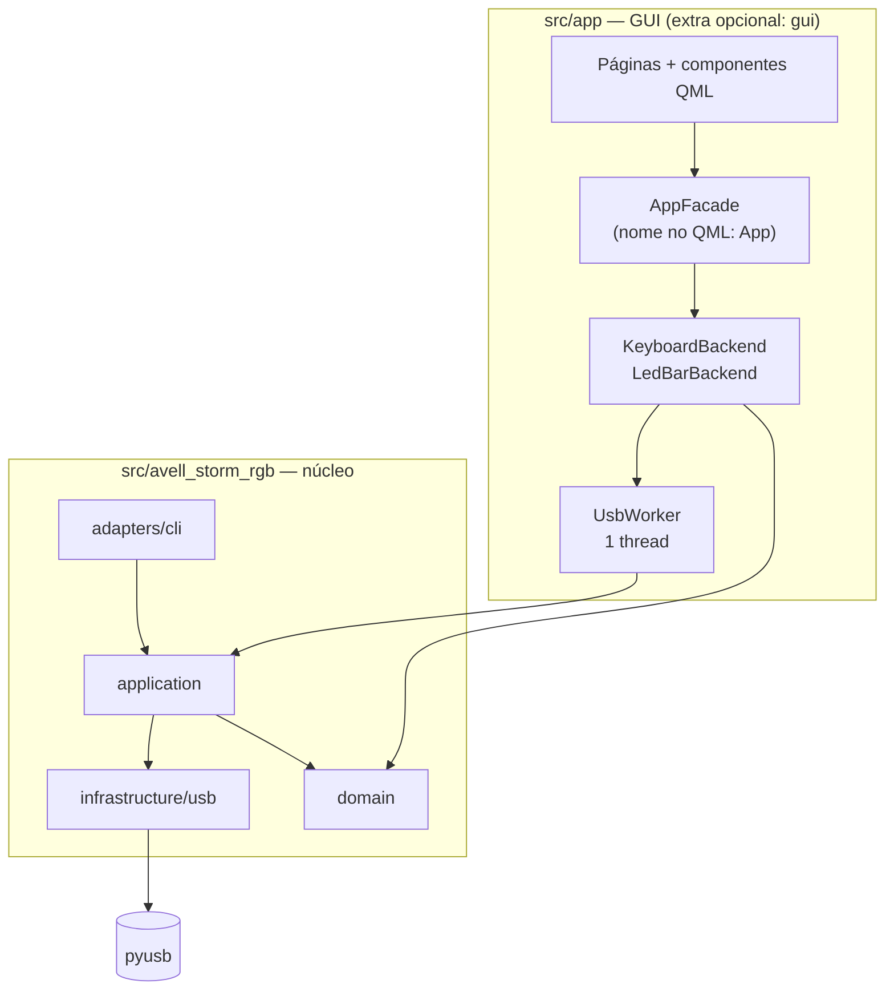
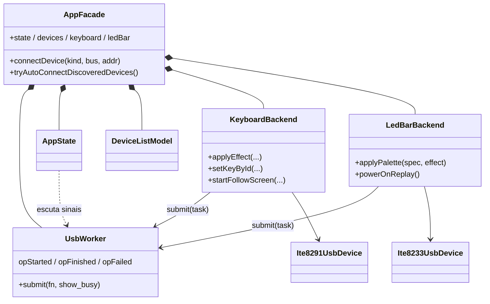

[🇺🇸 English](ARCHITECTURE.md) · 🇧🇷 Português

# Arquitetura

⏱️ **Leitura:** ~8 min

> **TL;DR**
> - Dois pacotes em `src/`: **`avell_storm_rgb`** (núcleo + CLI, em camadas) e **`app`** (GUI PySide6/QML). **`app` depende do núcleo, nunca o contrário.**
> - Na GUI, **todo I/O USB roda numa única thread em segundo plano** (`UsbWorker`). O QML nunca toca em USB.
> - O **protocolo de fio fica só em `infrastructure/usb/`**. Não mude bytes sem prova no hardware.

**Leia isto se…** você vai mudar código e precisa saber onde as coisas ficam e por quê.

---

## 🏗️ Visão geral

| Ponto de entrada | Script (`pyproject.toml`) | Função |
|------------------|---------------------------|--------|
| CLI | `avell-storm-rgb` | `src/avell_storm_rgb/adapters/cli/main.py:415` `main()` |
| GUI | `avell-storm-rgb-gui` | `src/app/main.py:19` `main()` |

## 🏗️ Pacote núcleo — `src/avell_storm_rgb/`

| Camada | Pasta | Contém | Arquivos-chave |
|--------|-------|--------|----------------|
| **domain** | `domain/` | Lógica pura, sem USB: DSL de animação, parsing de cor/paleta, layout por tecla, mapeamento de linha UI ↔ dispositivo | `anim_dsl.py`, `ledbar_colors.py`, `per_key_grid.py`, `keyboard_solid_colors.py` |
| **ports** | `ports/` | Tipos `Protocol` para os drivers (fakes de teste) | `protocols.py` |
| **application** | `application/` | Casos de uso: abrir/descrever dispositivos, follow-screen (X11, Wayland, despacho, amostragem de frame) | `device_facade.py`, `screen_follow*.py` |
| **infrastructure** | `infrastructure/usb/` | Drivers **fiéis ao protocolo**, tabelas de efeitos, descoberta | `ite8291_usb.py`, `ite8233_usb.py`, `discovery.py` |
| **adapters** | `adapters/cli/` | `argparse`; um handler `_cmd_*` por subcomando | `main.py` |

**Regra de dependência pretendida:** `adapters → application → domain / infrastructure`, e **domain continua puro**.

> [!WARNING]
> O código real dobra essa regra em alguns pontos. Veja **Dívidas conhecidas** no fim desta página.

## 🏗️ Pacote GUI — `src/app/`

| Caminho | Papel |
|---------|-------|
| `main.py` | Bootstrap: logging → estilo do Qt Quick Controls → `QApplication` → `QQmlApplicationEngine` → `AppFacade` como `App` → carrega `ui/main.qml` → bandeja |
| `qml_paths.py` | Adiciona os caminhos QML do Qt6 do sistema (Kirigami); escolhe o estilo `org.kde.desktop` (Breeze) ou `Fusion` |
| `tray.py` | `TrayController`: mostrar / esconder / sair pela bandeja do sistema |
| `logutil.py` | Logging no stderr; `--verbose` / `--debug` / `AVELL_STORM_RGB_LOG` |
| `core/usb_worker.py` | `UsbWorker`: fila de tarefas numa thread só |
| `core/devices.py` | Enumeração USB como dicts; `open_led_bar_at(bus, addr)` |
| `ui/adapters/` | `QObject`s expostos ao QML: `AppFacade`, `AppState`, `DeviceListModel`, `KeyboardBackend`, `LedBarBackend` |
| `ui/main.qml` | Casca: barra lateral, sub-navegação, `StackLayout` de conteúdo, véu de ocupado |
| `ui/pages/` | `DevicesPage`, `KeyboardPage`, `LedBarPage`, `SettingsPage`, `AppAboutPage` |
| `ui/components/` | QML reutilizável: `KeyboardLayoutView`, `ColorWell`, `EffectCard`, `SliderSpinRow`, `DeviceListPanel`, `BusyOverlay`, … |

**Contrato QML ↔ Python:** o QML só enxerga a context property `App` (`src/app/ui/adapters/app_facade.py:37`). Tudo é `Property` (ler), `Slot` (chamar) ou `Signal` (notificar). Exemplos: `App.keyboard.applyEffect(...)`, `App.ledBar.connected`, `App.state.busy`.

## 🏗️ Modelo de threads

| Thread | Roda | Regra |
|--------|------|-------|
| **Thread da GUI** | Event loop do Qt, QML, leitura de properties, timers de debounce | Nunca bloqueia em USB |
| **Thread USB** (`usb`) | `ThreadPoolExecutor(max_workers=1)` — `src/app/core/usb_worker.py:16` | Toda chamada USB vai para cá, **uma por vez, em ordem (FIFO)** |

**O padrão que todo slot de backend segue:**

1. O slot valida ou limita as entradas e atualiza o estado de sessão na thread da GUI.
2. Ele embrulha o trabalho USB numa função local `def task(): ...`.
3. Ele chama `self._worker.submit(task)`.
4. Os resultados voltam por **sinais** (vários usam `Qt.QueuedConnection` explicitamente).

**Ocupado e erros:**

- `submit(show_busy=True)` → `opStarted` → `AppState.busy` → o véu aparece.
- Uma exceção dentro de uma task → `opFailed(msg)` → `AppState.lastError` → mostrado na UI e logado no stderr.

> [!WARNING]
> **Uma thread USB só significa que tarefas longas travam a fila.** Enquanto follow-screen ou uma animação em loop roda, todo outro comando USB espera atrás dela (brilho, efeitos, **até a barra de LED**). Elas param por um `threading.Event` compartilhado (`_follow_stop`), acionado pelo **Stop**.

A **CLI não tem threads**: cada comando abre o dispositivo, executa e sai. `Ctrl+C` encerra os loops.

## 🏗️ Estado e persistência

| O quê | Onde fica | Sobrevive a reinício? |
|-------|-----------|-----------------------|
| Fechar para a bandeja, auto-connect | Chaves do `QSettings` `ui/closeToTray`, `ui/autoConnectOnStartup` | ✅ |
| Cores da paleta do teclado (para exibir) | `KeyboardBackend._palette_mirror` (espelho de sessão) | ❌ |
| Cores por tecla (coordenadas da UI) | `KeyboardBackend._key_colors` | ❌ |
| Parâmetros do último efeito de firmware (para reaplicar ao mudar brilho) | `KeyboardBackend._last_fw_*` | ❌ |
| Efeito do teclado antes de desligar | `KeyboardBackend._last_effect_snapshot` | ❌ |
| Último modo da barra de LED (replay ao ligar) | `LedBarBackend._last_replay` | ❌ |
| Brilho / velocidade / paleta da barra | Atributos do `Ite8233UsbDevice`; enviados com o próximo efeito | ❌ |
| Efeito dentro do teclado | Memória do controlador; `save=1` pede para persistir | Depende do hardware |

> [!NOTE]
> Os dispositivos **quase não podem ser lidos**. Só o teclado informa versão de FW, bytes do efeito atual, brilho e ligado/desligado. O resto que a GUI mostra vem de espelhos do que **esta sessão** enviou.

## 🏗️ Protocolo dos dispositivos numa tela

**Teclado — ITE 8291** (`src/avell_storm_rgb/infrastructure/usb/ite8291_usb.py`)

- **Comandos:** transferências de controle class/interface de 8 bytes (`bRequest 0x09`, `wValue 0x300`, `wIndex 1`).
  - `SET_EFFECT 8` · `SET_BRIGHTNESS 9` · `SET_PALETTE_COLOR 20` · `SET_ROW_INDEX 22` · `GET_FW_VERSION 128` · `GET_EFFECT 136`
- **Pacote de efeito:** `[control, effect, speed, brightness, color, direction|reactive, save]`.
- **Modo usuário:** uma chamada `SET_EFFECT` com efeito `51` (`0x33`). Necessário antes dos dados por tecla.
- **Dados por tecla:** para cada uma das 6 linhas, `SET_ROW_INDEX` e depois uma escrita OUT de 65 bytes (`3 × 21 + 2`). Bloco azul no offset 1, verde no 22, vermelho no 43.

**Barra de LED — ITE 8233** (`src/avell_storm_rgb/infrastructure/usb/ite8233_usb.py`)

- **Tudo** passa por `ctrl_transfer(0x21, 0x09, 0x0300, 0x0001, 8 bytes)`.
- **Comandos:** `CMD_EFFECT 0x08` · `CMD_STATE 0x12` · `CMD_COLOR 0x14` · `CMD_INIT 0x1A`.
- **Report de efeito:** `[0x08, 0x22, effect, speed, brightness, num_colors, 0, 0]`.

Matriz de parâmetros por efeito → [DEVICE_FEATURES_DEEP_DIVE](DEVICE_FEATURES_DEEP_DIVE.pt-BR.md).

## ⚠️ Dívidas conhecidas e pegadinhas

Encontradas durante o mapeamento do código. **Nenhuma foi corrigida ainda.**

| # | Achado | Onde | Por que importa |
|---|--------|------|-----------------|
| 1 | **Domain importa infrastructure** (`NUM_ROWS`, `NUM_COLS`) | `domain/anim_dsl.py:8`, `domain/per_key_grid.py:12` | Domain não é puro; o tamanho da grade pertence ao driver |
| 2 | **Tabelas de efeitos ficam em infrastructure** e os adapters importam direto, pulando `application` | CLI `main.py:23-24`, `app_facade.py:20-26` | A regra de camadas só vale em parte |
| 3 | **`ports/protocols.py` não é usado** em produção (só testes); as fachadas retornam classes concretas | `application/device_facade.py:22` | O port existe, mas ninguém depende dele |
| 4 | **`EFFECT_KWARGS` duplica** as listas de parâmetros de `KEYBOARD_EFFECTS` | `keyboard_backend.py:52` vs `ite8291_usb.py:102` | Adicionar um efeito exige editar os dois |
| 5 | **`_DEFAULT_PALETTE` duplica** `restore_default_palette()` | `keyboard_backend.py:82` vs `ite8291_usb.py:290` | Podem divergir |
| 6 | **Thread USB única** trava durante follow / animação em loop | `usb_worker.py:25` | Outras ações parecem congeladas até o Stop |
| 7 | **`show_busy=forever` parece invertido.** O véu aparece em loops "forever" e não nos finitos. A docstring de `UsbWorker.submit` diz que tarefas longas devem usar `show_busy=False` | `keyboard_backend.py:626` | Feedback confuso |
| 8 | **Follow-screen amostra 16 × 6**, então só as colunas de LED 0–15 de 21 acendem | `screen_follow_frame.py:13` | O lado direito do teclado fica apagado |
| 9 | **`KeyColorGrid.qml` não é usado** (substituído por `KeyboardLayoutView`) | `src/app/ui/components/` | Código morto |
| 10 | **"Test pattern" da GUI ≠ CLI**: a GUI manda um frame, a CLI roda 6 passos e restaura | `keyboard_backend.py:579` vs `cli/main.py:132` | Comportamento diferente, mesmo nome |
| 11 | **Descoberta da barra de LED duplicada**: `Ite8233UsbDevice._connect` repete `iter_led_bar_usb_devices`. A CLI sempre pega a primeira barra (sem `--device`) | `ite8233_usb.py:55`, `discovery.py:29` | Dois lugares para corrigir |
| 12 | **`refreshDevices()` enumera USB na thread da GUI** (não pelo worker) | `app_facade.py:242` | Pequeno engasgo na UI durante a varredura |
| 13 | **`test_gui_pages.py` importa PySide6 antes do `importorskip`** | `tests/test_gui_pages.py:6` | Sem o extra `gui`, `make test` dá erro em vez de pular |
