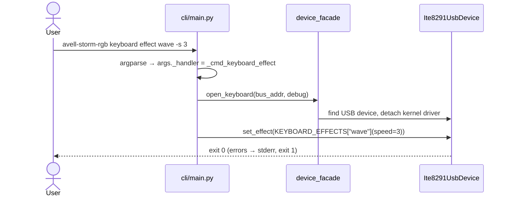
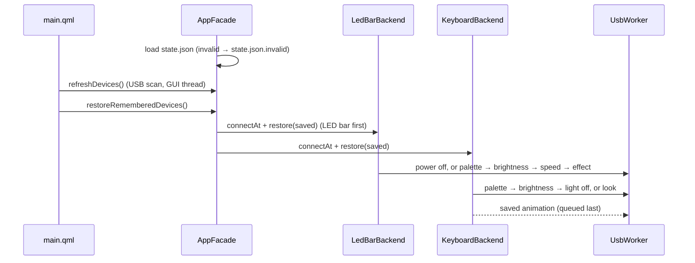
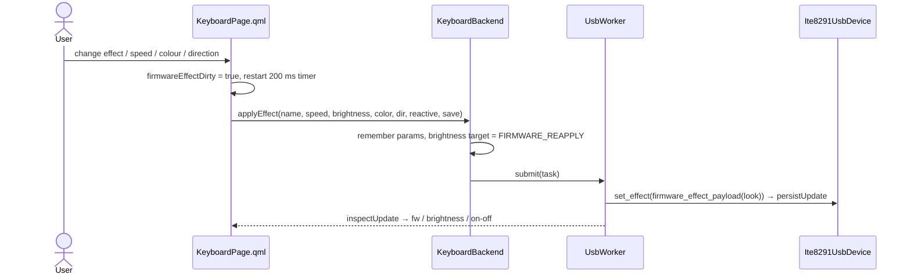
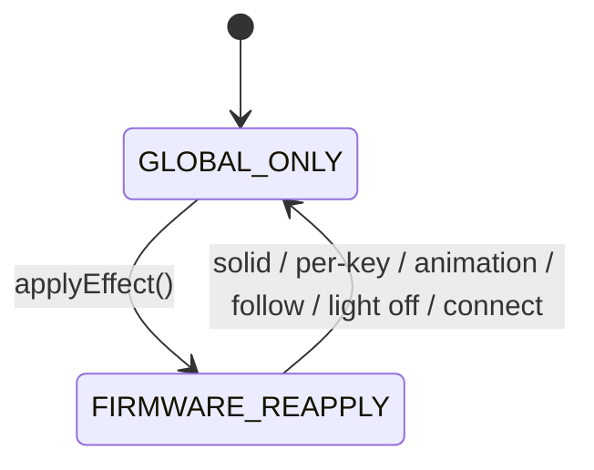
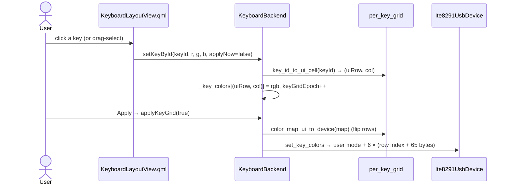
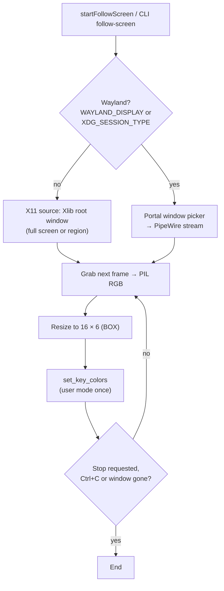
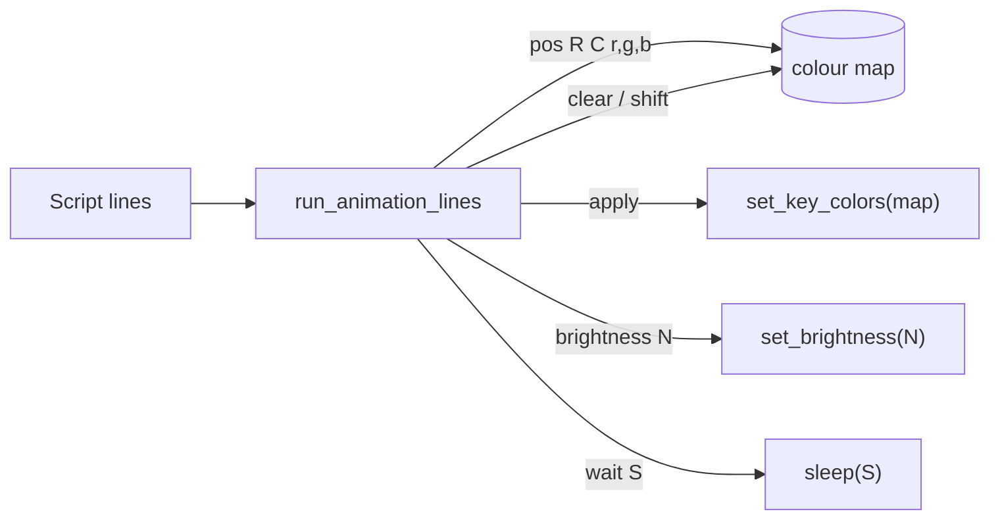

🇺🇸 English · [🇧🇷 Português](FLOWS.pt-BR.md)

# Flows

⏱️ **Reading time:** ~8 min (or ~1 min per flow)

> **TL;DR**
> - Eight step-by-step flows, **one per section**. Jump straight to the one you need.
> - GUI flows always follow the same shape: **QML → `App.<backend>.<slot>` → `UsbWorker` → driver → USB**.
> - Watch for the **Warning** callouts; they mark the non-obvious steps.

**Read this if…** you need to know *what happens* when someone clicks or runs something.

| # | Flow | Section |
|---|------|---------|
| 1 | CLI command | [1](#-1--cli-command) |
| 2 | GUI startup: reconnect and restore | [2](#-2--gui-startup-reconnect-and-restore) |
| 3 | Firmware effect from the GUI | [3](#-3--firmware-effect-from-the-gui) |
| 4 | Brightness slider | [4](#-4--brightness-slider) |
| 5 | Per-key colours | [5](#-5--per-key-colours) |
| 6 | Follow screen | [6](#-6--follow-screen) |
| 7 | Light switch | [7](#-7--light-switch) |
| 8 | Animation script | [8](#-8--animation-script) |

---

## 🔁 1 · CLI command

- **Every command opens the device fresh** and exits. Nothing is kept between runs.
- Handlers live in `src/avell_storm_rgb/adapters/cli/main.py` (`_cmd_*`). The parser is built in `_build_parser()` (`:273`).

## 🔁 2 · GUI startup: reconnect and restore

- Remembered devices are matched by **USB id** (`048d:ce00`), not bus/address. A missing one shows **Unavailable** in the sidebar, with **Retry** / **Forget**.
- **First start of this version** (no `state.json`): the old auto-connect setting is migrated once. The first keyboard and LED bar are remembered unless auto-connect was off.
- **Devices → Connect** remembers a device once the connection succeeds; **Disconnect** forgets it but keeps its saved look.
- **Saving:** every successful apply emits `persistUpdate`; `AppFacade` merges it and writes `state.json` (the only writer, on the GUI thread, atomic replace).
- If QML fails to load (Kirigami missing), `main()` prints a hint and exits 1.

## 🔁 3 · Firmware effect from the GUI

- **Debounce:** `fwEffectApplyTimer` (200 ms) in `src/app/ui/pages/KeyboardPage.qml:141`. Opening the tab or resizing **does not** send anything.
- **Filter:** `keyboard_effect_kwargs` (`ite8291_usb.py`) keeps only the parameters in `KEYBOARD_EFFECT_PARAMS` for that effect.
- **Saved:** after `set_effect` succeeds, the effect becomes the keyboard's saved look (`persistUpdate`).

> [!WARNING]
> The **colour** sent is a **palette slot index** (1–7, 8 = random, 0 = none), **not RGB**.

## 🔁 4 · Brightness slider

1. Slider moves → `requestBrightnessFromUi(fw0to50)` (`keyboard_backend.py:402`). The QML converts % → 0–50.
2. A 200 ms `QTimer` collapses rapid moves into one call.
3. The task sends `set_brightness(v)`.
4. **If** the target is `FIRMWARE_REAPPLY` and the keyboard is on, the last firmware effect is **re-sent with the new brightness**. The effect packet has its own brightness byte, which would otherwise override the change.

**LED bar:** `requestBrightnessFromUi(value, shellEffect)` → 200 ms debounce → `set_brightness_level` + `apply_visual_effect(last or shell effect)`. The bar **only** applies brightness together with an effect.

## 🔁 5 · Per-key colours

> [!WARNING]
> **Two coordinate systems.** GUI row 0 = **top** (F-keys). Device row 0 = **bottom**. Only the GUI per-key grid flips rows. **Animation scripts and follow-screen already use device coordinates.**

- Changes are **staged** (the dialogs pass `applyNow=false`). Nothing reaches the keyboard until **Apply**.
- QML repaints because each key's colour binding depends on `keyGridEpoch`.

## 🔁 6 · Follow screen

- **~10 fps** (0.1 s minimum between frames). Router: `screen_follow_dispatch.py:32`.
- **Wayland** ignores `--region`. You pick a **window**, not the whole desktop.
- In the GUI it runs with `show_busy=False`. **Stop** sets `_follow_stop`.

> [!WARNING]
> While it runs, it **holds the only USB thread**. Other GUI USB actions queue until you press Stop.

## 🔁 7 · Light switch

| Device | Switch **off** | Switch **on** |
|--------|----------------|---------------|
| **Keyboard** | Stop animation / follow → snapshot `get_effect()` → `turn_off()` | Re-apply the **saved look** (an animation restarts); else the snapshot; else firmware `rainbow` |
| **LED bar** | `power_off()` | `power_on()` + the saved look |

- The light state is **saved**. At startup, `off` turns the device off and the look is **not** applied.
- **Applying any look while the light is off turns it on** (and the switch follows).
- An unavailable device's switch is **disabled** and shows the saved light state.
- The CLI's `keyboard power off` / `led-bar power on|off` don't touch the saved state; `state restore` applies it.

## 🔁 8 · Animation script

- Parser: `src/avell_storm_rgb/domain/anim_dsl.py:20`. Grammar: [assets/animations/README](../assets/animations/README.md).
- **Comments:** lines starting with `#`, and nested `/* … */` blocks.
- **Loops:** CLI `--loop N` / `--forever`; GUI loops + "forever" checkbox. **Stop** sets the same `_follow_stop` event as follow-screen.
- Coordinates are **device rows** (row 0 = bottom).
