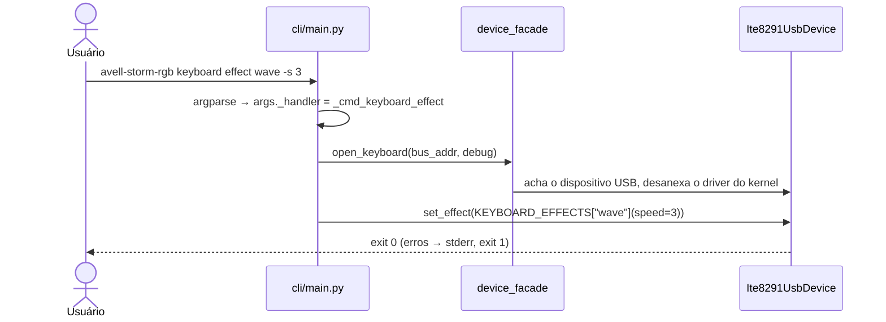
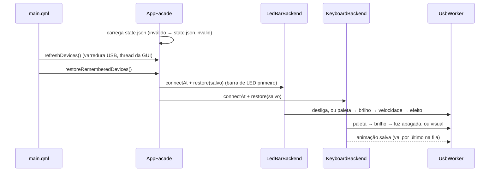
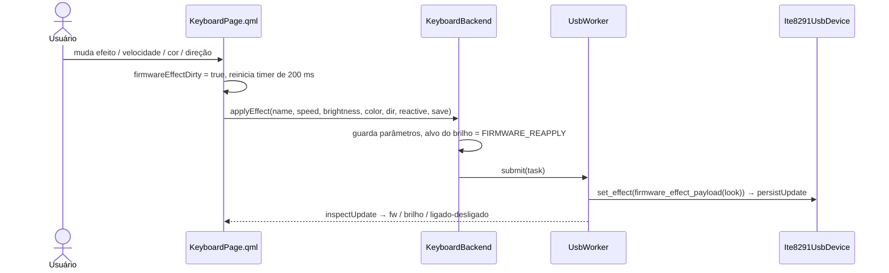
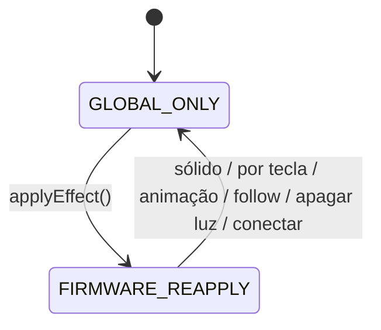
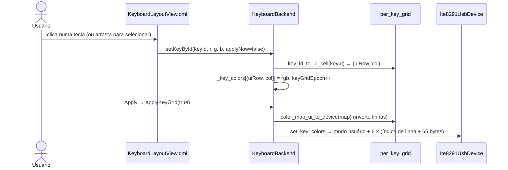
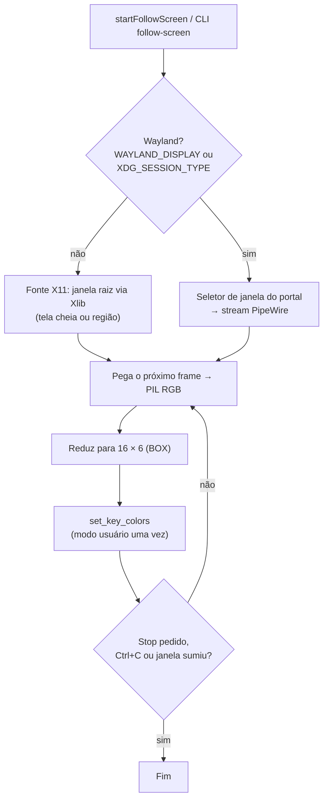
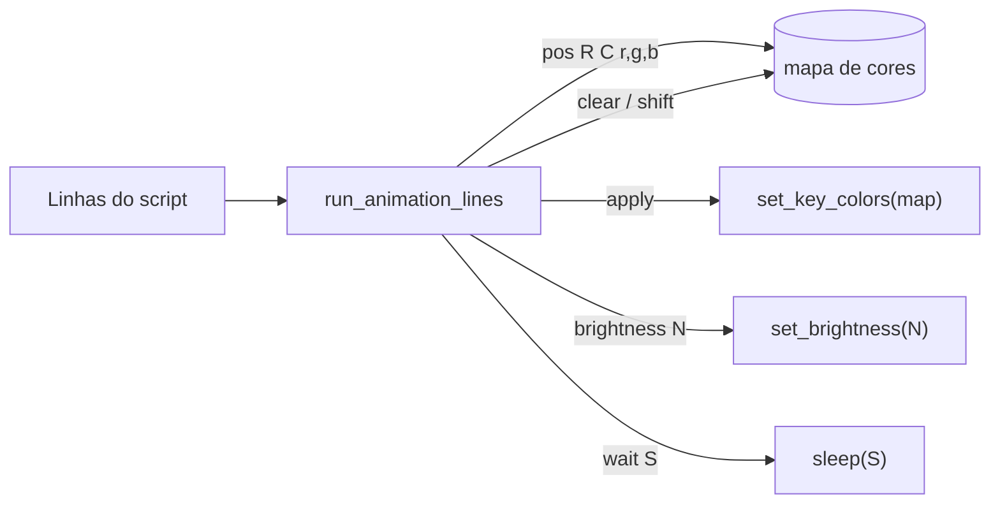
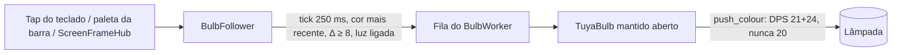

[🇺🇸 English](FLOWS.md) · 🇧🇷 Português

# Fluxos

⏱️ **Leitura:** ~8 min (ou ~1 min por fluxo)

> **TL;DR**
> - Oito fluxos passo a passo, **um por seção**. Pule direto para o que você precisa.
> - Os fluxos da GUI têm sempre o mesmo formato: **QML → `App.<backend>.<slot>` → `UsbWorker` → driver → USB**.
> - Fique de olho nos callouts de **Warning**: eles marcam os passos nada óbvios.

**Leia isto se…** você precisa saber *o que acontece* quando alguém clica ou roda algo.

| # | Fluxo | Seção |
|---|-------|-------|
| 1 | Comando da CLI | [1](#-1--comando-da-cli) |
| 2 | Inicialização da GUI: reconectar e restaurar | [2](#-2--inicialização-da-gui-reconectar-e-restaurar) |
| 3 | Efeito de firmware pela GUI | [3](#-3--efeito-de-firmware-pela-gui) |
| 4 | Slider de brilho | [4](#-4--slider-de-brilho) |
| 5 | Cores por tecla | [5](#-5--cores-por-tecla) |
| 6 | Seguir a tela | [6](#-6--seguir-a-tela) |
| 7 | Switch de luz | [7](#-7--switch-de-luz) |
| 8 | Script de animação | [8](#-8--script-de-animação) |

---

## 🔁 1 · Comando da CLI

- **Todo comando abre o dispositivo do zero** e termina. Nada fica guardado entre execuções.
- Os handlers ficam em `src/avell_storm_rgb/adapters/cli/main.py` (`_cmd_*`). O parser é montado em `_build_parser()` (`:273`).

## 🔁 2 · Inicialização da GUI: reconectar e restaurar

- Dispositivos lembrados são encontrados pelo **USB id** (`048d:ce00`), não por bus/endereço. Um ausente aparece como **Unavailable** na barra lateral, com **Retry** / **Forget**.
- **Primeira abertura desta versão** (sem `state.json`): a antiga opção de auto-connect é migrada uma vez. O primeiro teclado e a primeira barra são lembrados, a menos que o auto-connect estivesse desligado.
- **Devices → Connect** lembra o dispositivo quando a conexão dá certo; **Disconnect** esquece, mas mantém o visual salvo.
- **Salvamento:** toda aplicação bem-sucedida emite `persistUpdate`; o `AppFacade` junta e grava o `state.json` (único escritor, na thread da GUI, com substituição atômica).
- Se o QML não carregar (Kirigami ausente), `main()` imprime uma dica e sai com 1.

## 🔁 3 · Efeito de firmware pela GUI

- **Debounce:** `fwEffectApplyTimer` (200 ms) em `src/app/ui/pages/KeyboardPage.qml:141`. Abrir a aba ou redimensionar **não** envia nada.
- **Filtro:** `keyboard_effect_kwargs` (`ite8291_usb.py`) mantém só os parâmetros de `KEYBOARD_EFFECT_PARAMS` para aquele efeito.
- **Salvo:** depois que o `set_effect` dá certo, o efeito vira o visual salvo do teclado (`persistUpdate`).

> [!WARNING]
> A **cor** enviada é um **índice de slot da paleta** (1–7, 8 = random, 0 = none), **não RGB**.

## 🔁 4 · Slider de brilho

1. O slider se move → `requestBrightnessFromUi(fw0a50)` (`keyboard_backend.py:402`). O QML converte % → 0–50.
2. Um `QTimer` de 200 ms junta movimentos rápidos numa chamada só.
3. A task envia `set_brightness(v)`.
4. **Se** o alvo for `FIRMWARE_REAPPLY` e o teclado estiver ligado, o último efeito de firmware é **reenviado com o novo brilho**. O pacote de efeito tem seu próprio byte de brilho, que senão desfaria a mudança.

**Barra de LED:** `requestBrightnessFromUi(value, shellEffect)` → debounce de 200 ms → `set_brightness_level` + `apply_visual_effect(último efeito ou o da casca)`. A barra **só** aplica brilho junto com um efeito.

## 🔁 5 · Cores por tecla

> [!WARNING]
> **Dois sistemas de coordenadas.** Linha 0 da GUI = **topo** (teclas F). Linha 0 do dispositivo = **base**. Só a grade por tecla da GUI inverte as linhas. **Scripts de animação e follow-screen já usam coordenadas do dispositivo.**

- As mudanças ficam **preparadas** (os diálogos passam `applyNow=false`). Nada chega ao teclado até o **Apply**.
- O QML redesenha porque o binding de cor de cada tecla depende de `keyGridEpoch`.

## 🔁 6 · Seguir a tela

- **~10 fps** (mínimo de 0,1 s entre frames). Roteador: `screen_follow_dispatch.py:32`.
- O **Wayland** ignora `--region`. Você escolhe uma **janela**, não o desktop inteiro.
- Na GUI roda com `show_busy=False`. O **Stop** aciona `_follow_stop`.

> [!WARNING]
> Enquanto roda, ele **segura a única thread USB**. Outras ações USB da GUI ficam na fila até você apertar Stop.

## 🔁 7 · Switch de luz

| Dispositivo | Switch **desligado** | Switch **ligado** |
|-------------|----------------------|-------------------|
| **Teclado** | Para animação / follow → snapshot de `get_effect()` → `turn_off()` | Reaplica o **visual salvo** (uma animação recomeça); senão o snapshot; senão o firmware `rainbow` |
| **Barra de LED** | `power_off()` | `power_on()` + o visual salvo |

- O estado da luz é **salvo**. Ao abrir, `off` desliga o dispositivo e o visual **não** é aplicado.
- **Aplicar qualquer visual com a luz apagada acende a luz** (e o switch acompanha).
- O switch de um dispositivo indisponível fica **desabilitado** e mostra o estado de luz salvo.
- `keyboard power off` / `led-bar power on|off` da CLI não mexem no estado salvo; `state restore` aplica o estado salvo.

## 🔁 8 · Script de animação

- Parser: `src/avell_storm_rgb/domain/anim_dsl.py:20`. Gramática: [assets/animations/README](../assets/animations/README.pt-BR.md).
- **Comentários:** linhas começando com `#`, e blocos aninhados `/* … */`.
- **Loops:** na CLI, `--loop N` / `--forever`; na GUI, contador de loops + checkbox "forever". O **Stop** aciona o mesmo evento `_follow_stop` do follow-screen.
- As coordenadas são **linhas do dispositivo** (linha 0 = base).

## 🔁 9 · Lâmpadas Tuya

**Connect (GUI):** `connectBulb(id)` → `BulbWorker` (thread `bulb-*`) abre o driver, lê `status()`, fecha →
`opDone` (thread da GUI) → cache da linha → `persistUpdate(id, {"remembered": True})` → `AppFacade` grava o `state.json`.
Inalcançável → nada é lembrado, `opFailed` → erro inline.

**Abertura:** `restoreRememberedDevices()` restaura barra de LED e teclado, depois `bulbs.refresh()` **lê** cada lâmpada lembrada.
Nenhum comando é enviado. Com a janela visível, um timer de 30 s repete as leituras.

**Follow:** a cor da fonte vai para o follower; cada tick envia no máximo uma cor, só se mudou o bastante e a última
leitura diz que a lâmpada está ligada. Uma leitura a cada 5 s, enquanto segue, percebe a lâmpada desligada pelo celular.

> [!WARNING]
> Remover uma lâmpada que está seguindo para o follower e fecha o socket **antes** de gravar o inventário
> (os dois vão para a fila FIFO daquela lâmpada).
