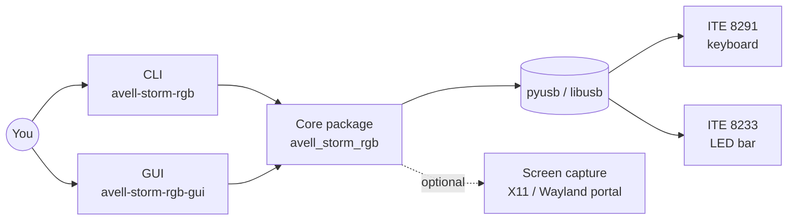
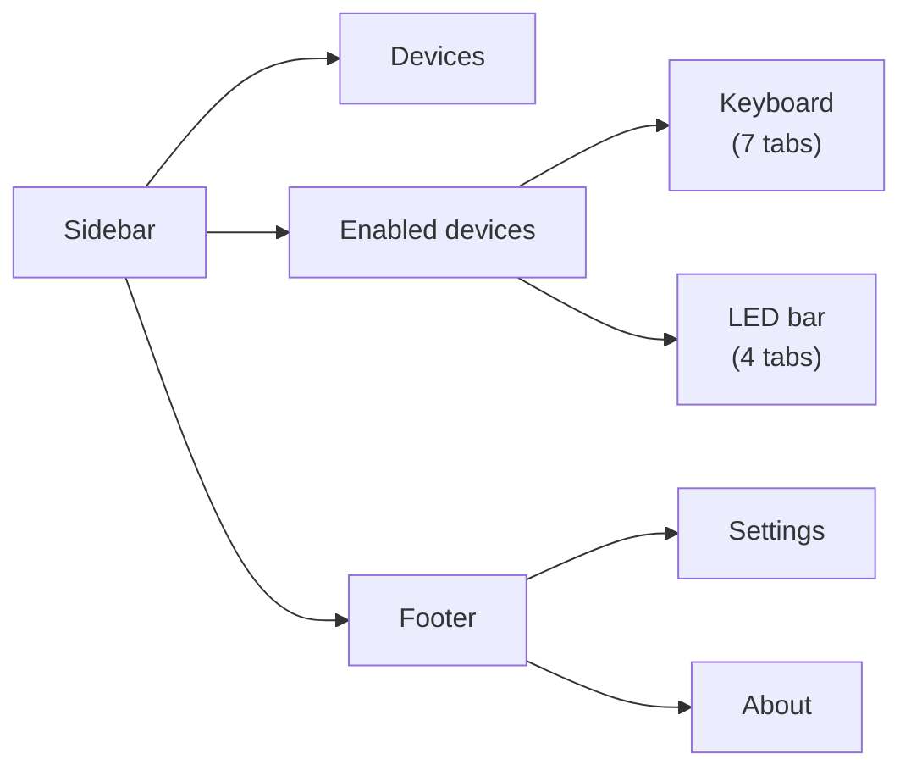

🇺🇸 English · [🇧🇷 Português](OVERVIEW.pt-BR.md)

# Overview

⏱️ **Reading time:** ~4 min

> **TL;DR**
> - A **Linux** tool that controls the **RGB lights** of Avell Storm laptops (and other laptops with the same ITE chips) over **USB**.
> - It drives **two devices**: the **ITE 8291** keyboard backlight (per-key RGB) and the **ITE 8233** LED bar.
> - It has **two front-ends** on top of one Python core: the CLI **`avell-storm-rgb`** and the KDE/Plasma desktop GUI **`avell-storm-rgb-gui`**.

**Read this if…** this is your first contact with the project.

---

## 🧭 What it is

- **No kernel driver, no daemon.** The program talks to the chips directly with USB control transfers.
- **Remembers your lights.** The GUI saves the devices you connected, their light state and their last look in `~/.config/avell-storm-rgb/state.json`, and restores them when it opens (see *State and persistence* in [ARCHITECTURE](ARCHITECTURE.md)).

## 🧭 The two devices

| | Keyboard — ITE 8291 | LED bar — ITE 8233 |
|---|---|---|
| **USB IDs** | `048d:6004`, `6006`, `ce00`, `600b`, rev `0.03` | `048d:7000`, `7001`, or product name contains `8233` |
| **Driver class** | `Ite8291UsbDevice` — `src/avell_storm_rgb/infrastructure/usb/ite8291_usb.py:173` | `Ite8233UsbDevice` — `src/avell_storm_rgb/infrastructure/usb/ite8233_usb.py:28` |
| **Brightness** | **0–50** | **0–100** |
| **Firmware effects** | 9: breathing, wave, random, rainbow, ripple, marquee, raindrop, aurora, fireworks | 5: static, breathing, wave, impact, raindrop |
| **Custom colours** | Solid colour, **per-key** (6 × 21 grid), animation scripts, follow-screen | One static colour, or a palette |
| **Palette** | **7 slots** stored inside the controller | List of **≤ 9** colours sent with each effect |

> [!WARNING]
> **Brightness scales differ.** Keyboard is 0–50, LED bar is 0–100. The GUI shows the keyboard as **0–100 %** and converts to 0–50 before sending.

## 🧭 Features: CLI vs GUI

| Feature | CLI | GUI |
|---------|-----|-----|
| List devices | `device list` | **Devices** page |
| Keyboard light on / off | `keyboard power off` (off only) | Sidebar **switch** (on re-applies the saved look) |
| Keyboard brightness | `keyboard brightness N` | Slider (debounced) |
| Firmware effect | `keyboard effect NAME …` | **Effect** tab (auto-applies) |
| Palette slots 1–7 | `keyboard palette restore \| random \| set-slot` | **Palette slot configuration** tab |
| Solid colour | `keyboard solid-color` | **Solid color** tab |
| Per-key colours | only through an animation script | **Per-key grid** tab (click / drag on a real keyboard layout) |
| Animation script | `keyboard play-animation` | **Animation file** tab |
| Follow screen | `keyboard follow-screen` | **Follow screen** tab |
| Test pattern / freeze | `demo-test-pattern`, `freeze-animation` | **Tools** tab |
| Inspect (FW, brightness, on/off) | `keyboard inspect` | Shown on the page |
| LED bar light on / off | `led-bar power on \| off` | Sidebar **switch** |
| LED bar colour, palette, effect, brightness, speed | `led-bar color \| palette \| effect \| brightness \| speed` | 4 tabs |
| Remember devices and restore their last look at startup | `state show` · `state restore` | ✅ automatic |
| Tray icon, close to tray | — | ✅ GUI only |

## 🧭 GUI tour

- **Devices:** USB scan. **Connect remembers** a device; **Disconnect forgets** it (its saved look is kept).
- Only **remembered** devices appear in the sidebar. Their **switch** turns the **light** on/off.
- A remembered device that is unplugged shows **Unavailable**; its page offers **Retry** and **Forget**.

| Keyboard tabs | | LED bar tabs |
|---|---|---|
| **Firmware:** Effect · Palette slot configuration | | Color (named / hex) |
| **User-defined:** Solid color · Per-key grid · Animation file · Follow screen | | Preset + effect |
| **Extra:** Tools | | Effect only · Brightness & motion |

- **Settings:** close to tray, verbose USB for keyboard, quit.
- A translucent **"USB operation in progress…"** overlay appears while a USB task runs.

## 🛠️ Optional parts

| Extra (`uv sync --extra …`) | Python deps | Needs from the OS |
|-----------------------------|-------------|-------------------|
| *(base)* | `pyusb` | libusb + **udev rules** (or root) |
| `gui` | `PySide6` | **Kirigami 6** QML, ideally **qqc2-breeze-style**, a system tray |
| `screen` | `python-xlib`, `Pillow`, `pipewire-capture`, `numpy` | **X11** session, **or** Wayland + **xdg-desktop-portal** + **PipeWire** |

## ⚠️ Gotchas worth knowing early

- **The firmware effect "colour" is not RGB.** It is an *index* into the 7 palette slots (or `random`/`none`). See [GLOSSARY](GLOSSARY.md#keyboard).
- **Direction and reactive share one byte.** An effect uses one or the other, never both.
- **Per-key rows are flipped.** The GUI counts row 0 from the top; the device counts row 0 from the bottom.
- **Follow-screen and looping animations hold the single USB thread** in the GUI. Other USB actions wait until you press Stop.

## 🧭 Origins and licence

- Keyboard protocol ported from [ite8291r3-ctl](https://github.com/pobrn/ite8291r3-ctl) (GPL-2.0).
- LED bar protocol ported from **ite8233-ledbar** (MIT).
- This project: **GPL-2.0-or-later**. Details in [`NOTICE`](../NOTICE) and [`LICENSE`](../LICENSE).

## Next

- How the code is built → [ARCHITECTURE](ARCHITECTURE.md)
- What happens step by step → [FLOWS](FLOWS.md)
- Set up and run → [DEVELOPMENT](DEVELOPMENT.md)
