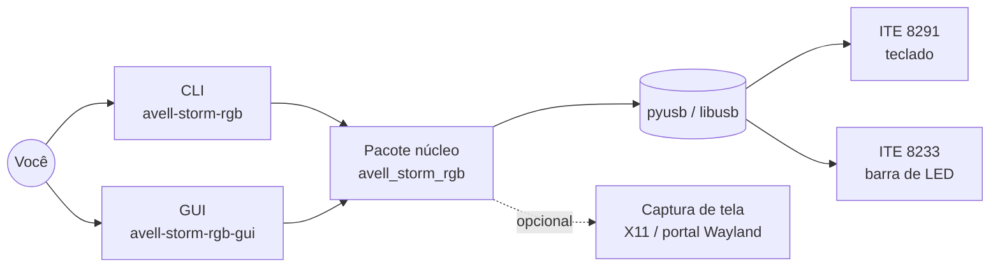
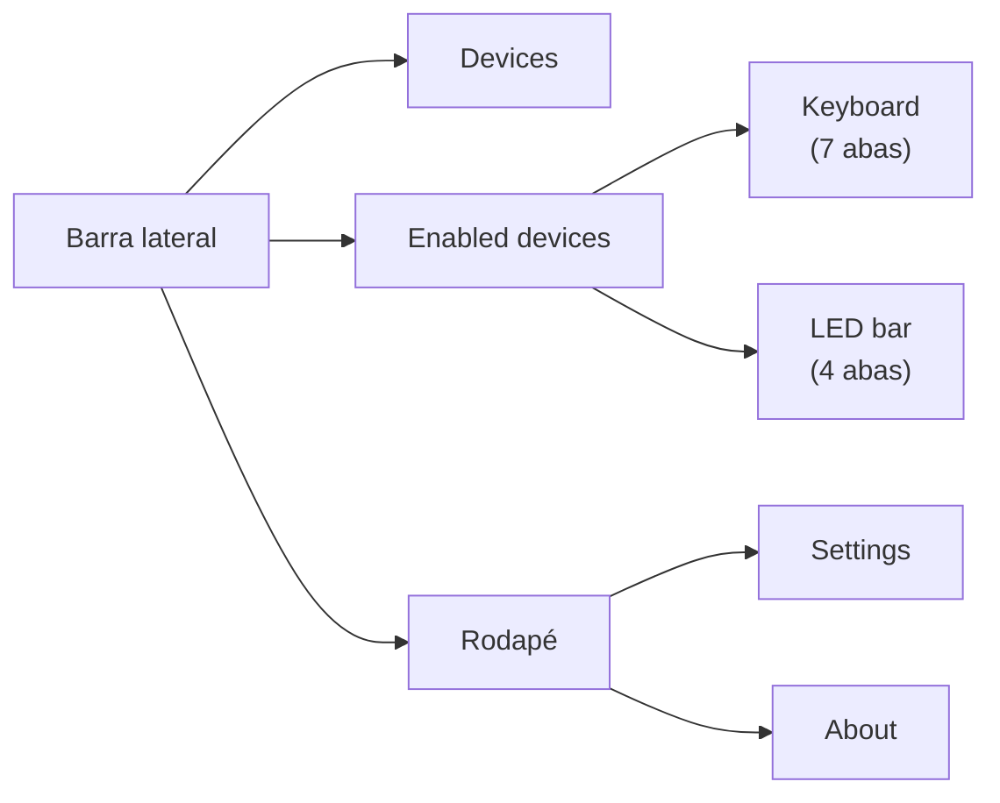

[🇺🇸 English](OVERVIEW.md) · 🇧🇷 Português

# Visão geral

⏱️ **Leitura:** ~4 min

> **TL;DR**
> - Ferramenta para **Linux** que controla as **luzes RGB** dos notebooks Avell Storm (e de outros com os mesmos chips ITE) via **USB**.
> - Controla **dois dispositivos**: a retroiluminação do teclado **ITE 8291** (RGB por tecla) e a barra de LED **ITE 8233**.
> - Tem **duas interfaces** sobre um mesmo núcleo Python: a CLI **`avell-storm-rgb`** e a GUI desktop KDE/Plasma **`avell-storm-rgb-gui`**.

**Leia isto se…** este é seu primeiro contato com o projeto.

---

## 🧭 O que é

- **Sem driver de kernel, sem daemon.** O programa fala direto com os chips por transferências de controle USB.
- **Lembra das suas luzes.** A GUI salva os dispositivos que você conectou, o estado da luz e o último visual em `~/.config/avell-storm-rgb/state.json`, e restaura tudo ao abrir (veja *Estado e persistência* em [ARCHITECTURE](ARCHITECTURE.pt-BR.md)).

## 🧭 Os dois dispositivos

| | Teclado — ITE 8291 | Barra de LED — ITE 8233 |
|---|---|---|
| **IDs USB** | `048d:6004`, `6006`, `ce00`, `600b`, rev `0.03` | `048d:7000`, `7001`, ou nome do produto contém `8233` |
| **Classe do driver** | `Ite8291UsbDevice` — `src/avell_storm_rgb/infrastructure/usb/ite8291_usb.py:173` | `Ite8233UsbDevice` — `src/avell_storm_rgb/infrastructure/usb/ite8233_usb.py:28` |
| **Brilho** | **0–50** | **0–100** |
| **Efeitos de firmware** | 9: breathing, wave, random, rainbow, ripple, marquee, raindrop, aurora, fireworks | 5: static, breathing, wave, impact, raindrop |
| **Cores personalizadas** | Cor sólida, **por tecla** (grade 6 × 21), scripts de animação, follow-screen | Uma cor estática, ou uma paleta |
| **Paleta** | **7 slots** guardados dentro do controlador | Lista de **≤ 9** cores enviada junto com cada efeito |

> [!WARNING]
> **As escalas de brilho são diferentes.** Teclado vai de 0–50, barra de LED de 0–100. A GUI mostra o teclado como **0–100 %** e converte para 0–50 antes de enviar.

## 🧭 Funcionalidades: CLI vs GUI

| Funcionalidade | CLI | GUI |
|----------------|-----|-----|
| Listar dispositivos | `device list` | Página **Devices** |
| Ligar/desligar a luz do teclado | `keyboard power off` (só desligar) | **Switch** da barra lateral (ligar reaplica o visual salvo) |
| Brilho do teclado | `keyboard brightness N` | Slider (com debounce) |
| Efeito de firmware | `keyboard effect NOME …` | Aba **Effect** (aplica sozinho) |
| Slots de paleta 1–7 | `keyboard palette restore \| random \| set-slot` | Aba **Palette slot configuration** |
| Cor sólida | `keyboard solid-color` | Aba **Solid color** |
| Cores por tecla | só via script de animação | Aba **Per-key grid** (clicar / arrastar num layout de teclado real) |
| Script de animação | `keyboard play-animation` | Aba **Animation file** |
| Seguir a tela | `keyboard follow-screen` | Aba **Follow screen** |
| Padrão de teste / congelar | `demo-test-pattern`, `freeze-animation` | Aba **Tools** |
| Inspecionar (FW, brilho, ligado/desligado) | `keyboard inspect` | Mostrado na página |
| Ligar/desligar a luz da barra de LED | `led-bar power on \| off` | **Switch** da barra lateral |
| Cor, paleta, efeito, brilho, velocidade da barra | `led-bar color \| palette \| effect \| brightness \| speed` | 4 abas |
| Lembrar dispositivos e restaurar o último visual ao abrir | `state show` · `state restore` | ✅ automático |
| Ícone na bandeja, fechar para a bandeja | — | ✅ só na GUI |

## 🧭 Tour pela GUI

- **Devices:** varredura USB. **Connect lembra** o dispositivo; **Disconnect esquece** (o visual salvo é mantido).
- Só dispositivos **lembrados** aparecem na barra lateral. O **switch** deles liga/desliga a **luz**.
- Um dispositivo lembrado que está desconectado do USB aparece como **Unavailable**; a página dele oferece **Retry** e **Forget**.

| Abas do teclado | | Abas da barra de LED |
|---|---|---|
| **Firmware:** Effect · Palette slot configuration | | Color (named / hex) |
| **User-defined:** Solid color · Per-key grid · Animation file · Follow screen | | Preset + effect |
| **Extra:** Tools | | Effect only · Brightness & motion |

- **Settings:** fechar para a bandeja, USB verboso para o teclado, sair.
- Um véu translúcido **"USB operation in progress…"** aparece enquanto uma tarefa USB roda.

> [!NOTE]
> Os nomes de telas e abas ficam **em inglês** porque é assim que aparecem na interface.

## 🛠️ Partes opcionais

| Extra (`uv sync --extra …`) | Dependências Python | Precisa do sistema |
|-----------------------------|---------------------|--------------------|
| *(base)* | `pyusb` | libusb + **regras udev** (ou root) |
| `gui` | `PySide6` | QML do **Kirigami 6**, de preferência **qqc2-breeze-style**, uma bandeja do sistema |
| `screen` | `python-xlib`, `Pillow`, `pipewire-capture`, `numpy` | Sessão **X11**, **ou** Wayland + **xdg-desktop-portal** + **PipeWire** |

## 🧭 Lâmpadas inteligentes Tuya (opcional)

| | |
|-|-|
| **Instalar** | `uv sync --extra tuya` (a GUI também precisa de `--extra gui`). Sem ele, nenhuma tela de lâmpada existe |
| **Fatia 1** | Importar o `devices.json` do tinytuya; Connect/Disconnect/Remove; interruptor na sidebar; página com brilho, temperatura do branco, cor; CLI `bulb …` |
| **Fatia 2** | **Follow**: a lâmpada pega a cor do teclado, da tela (uma captura compartilhada) ou da barra de LED |
| **Nunca** | Altera uma lâmpada ao abrir, usa a nuvem durante o uso, ou mostra uma chave local |

Detalhes → [BULBS](BULBS.pt-BR.md).

## ⚠️ Pegadinhas para saber cedo

- **A "cor" do efeito de firmware não é RGB.** É um *índice* para os 7 slots da paleta (ou `random`/`none`). Veja [GLOSSARY](GLOSSARY.pt-BR.md#teclado).
- **Direção e reativo dividem o mesmo byte.** Um efeito usa um ou outro, nunca os dois.
- **As linhas por tecla são invertidas.** A GUI conta a linha 0 de cima; o dispositivo conta a linha 0 de baixo.
- **Follow-screen e animações em loop seguram a única thread USB** da GUI. Outras ações USB esperam até você apertar Stop.

## 🧭 Origem e licença

- Protocolo do teclado portado do [ite8291r3-ctl](https://github.com/pobrn/ite8291r3-ctl) (GPL-2.0).
- Protocolo da barra de LED portado do **ite8233-ledbar** (MIT).
- Este projeto: **GPL-2.0-or-later**. Detalhes em [`NOTICE`](../NOTICE) e [`LICENSE`](../LICENSE).

## Próximos passos

- Como o código é construído → [ARCHITECTURE](ARCHITECTURE.pt-BR.md)
- O que acontece passo a passo → [FLOWS](FLOWS.pt-BR.md)
- Montar e rodar → [DEVELOPMENT](DEVELOPMENT.pt-BR.md)
