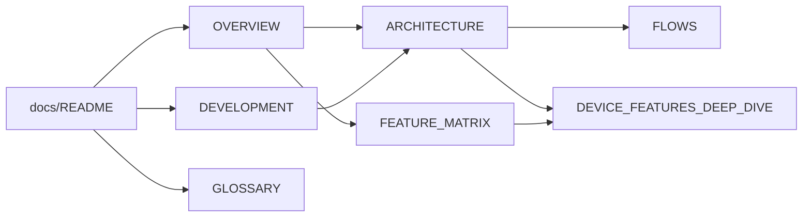

🇺🇸 English · [🇧🇷 Português](README.pt-BR.md)

# Documentation index

⏱️ **Reading time:** ~2 min

> **TL;DR**
> - Every doc exists in **two languages**: `NAME.md` (English) and `NAME.pt-BR.md` (Brazilian Portuguese).
> - Pick your goal in the table below and read **only** that doc first.
> - Unknown word? → [GLOSSARY](GLOSSARY.md).

**Read this if…** you just landed here and don't know where to start.

---

## 🧭 Pick your path

| I want to… | Read | Time |
|------------|------|------|
| Understand what this project is | [OVERVIEW](OVERVIEW.md) | ~4 min |
| Install and use the CLI or GUI | [Root README](../README.md) | ~5 min |
| Set up a dev environment, run tests, follow a recipe | [DEVELOPMENT](DEVELOPMENT.md) | ~6 min |
| Understand how the code is organised | [ARCHITECTURE](ARCHITECTURE.md) | ~8 min |
| Follow what happens when I click/run something | [FLOWS](FLOWS.md) | ~8 min |
| Check which feature is supported where | [FEATURE_MATRIX](FEATURE_MATRIX.md) | ~2 min |
| Understand effects, parameters and exclusions per device | [DEVICE_FEATURES_DEEP_DIVE](DEVICE_FEATURES_DEEP_DIVE.md) | ~10 min |
| Write a per-key animation script | [assets/animations/README](../assets/animations/README.md) | ~3 min |
| Decode a term | [GLOSSARY](GLOSSARY.md) | lookup |

> [!TIP]
> **Agents:** start at [`AGENTS.md`](../AGENTS.md) (repo rules), then [ARCHITECTURE](ARCHITECTURE.md). GUI work also loads [`src/app/AGENTS.md`](../src/app/AGENTS.md) and [`src/app/ui/AGENTS.md`](../src/app/ui/AGENTS.md).

## 🧭 How the docs connect

---

## 🛠️ How these docs are written

These rules apply to every Markdown doc in the repo.

**Bilingual pairs**

- `NAME.md` = **English**, `NAME.pt-BR.md` = **Brazilian Portuguese**, side by side in the same folder.
- First line of each file links to the other language.
- **Change one → change the other in the same commit.**

**Exceptions (single language, English only)**

| File | Why |
|------|-----|
| `AGENTS.md`, `CLAUDE.md` (root, `src/app/`, `src/app/ui/`) | Loaded by exact filename as agent instructions; a second language would duplicate rules |
| `LICENSE`, `NOTICE` | Legal text |
| `.compozy/tasks/**` (specs, stories, tests, ADRs, task files) | Working artifacts of the spec-cycle pipeline, consumed by agents; two languages would double them and invite contract drift |

**Style (ADHD-friendly)**

- Header: language link → ⏱️ reading time → **TL;DR** (≤ 3 bullets) → **Read this if…**
- At most ~5 lines of prose in a row; then a table, list or diagram.
- GitHub callouts for attention: `> [!TIP]`, `> [!NOTE]`, `> [!WARNING]`.
- **Bold** keywords so the page can be skimmed.
- Code references as `path:line` (clickable, greppable).
- Mermaid diagrams small (≤ ~12 nodes); split when bigger.
- Fixed section emojis only: 🧭 orientation · 🏗️ architecture · 🔁 flow · ⚠️ gotcha · 🛠️ how-to.
- Files ≤ ~250 lines; split when bigger.

## 🛠️ Keep docs in sync

| When you change… | Also update |
|------------------|-------------|
| A CLI command or flag | Root README usage, FEATURE_MATRIX, OVERVIEW feature table |
| A firmware effect or its parameters | FEATURE_MATRIX, DEVICE_FEATURES_DEEP_DIVE, DEVELOPMENT recipe if steps change |
| Layers, threading, backends | ARCHITECTURE, FLOWS |
| A GUI page or tab | OVERVIEW GUI tour, DEVICE_FEATURES_DEEP_DIVE "UI ↔ backend" |
| Env vars, extras, setup | DEVELOPMENT, root README |
| A new concept or name | GLOSSARY |
