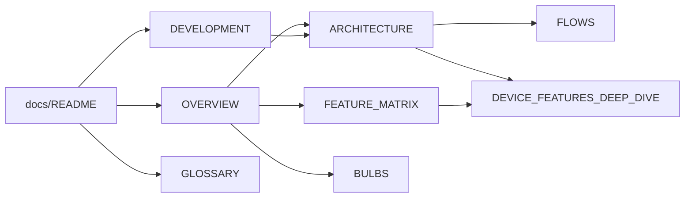

[🇺🇸 English](README.md) · 🇧🇷 Português

# Índice da documentação

⏱️ **Leitura:** ~2 min

> **TL;DR**
> - Todo doc existe em **dois idiomas**: `NOME.md` (inglês) e `NOME.pt-BR.md` (português do Brasil).
> - Escolha seu objetivo na tabela abaixo e leia **só** aquele doc primeiro.
> - Palavra desconhecida? → [GLOSSARY](GLOSSARY.pt-BR.md).

**Leia isto se…** você acabou de chegar e não sabe por onde começar.

---

## 🧭 Escolha seu caminho

| Eu quero… | Leia | Tempo |
|-----------|------|-------|
| Entender o que é este projeto | [OVERVIEW](OVERVIEW.pt-BR.md) | ~4 min |
| Instalar e usar a CLI ou a GUI | [README da raiz](../README.pt-BR.md) | ~5 min |
| Montar o ambiente de dev, rodar testes, seguir uma receita | [DEVELOPMENT](DEVELOPMENT.pt-BR.md) | ~6 min |
| Entender como o código está organizado | [ARCHITECTURE](ARCHITECTURE.pt-BR.md) | ~8 min |
| Acompanhar o que acontece quando clico/rodo algo | [FLOWS](FLOWS.pt-BR.md) | ~8 min |
| Ver qual funcionalidade é suportada onde | [FEATURE_MATRIX](FEATURE_MATRIX.pt-BR.md) | ~2 min |
| Entender efeitos, parâmetros e exclusões por dispositivo | [DEVICE_FEATURES_DEEP_DIVE](DEVICE_FEATURES_DEEP_DIVE.pt-BR.md) | ~10 min |
| Escrever um script de animação por tecla | [assets/animations/README](../assets/animations/README.pt-BR.md) | ~3 min |
| Controlar lâmpadas inteligentes Tuya (opcional) | [BULBS](BULBS.pt-BR.md) | ~6 min |
| Decifrar um termo | [GLOSSARY](GLOSSARY.pt-BR.md) | consulta |

> [!TIP]
> **Agentes:** comecem pelo [`AGENTS.md`](../AGENTS.md) (regras do repo) e depois [ARCHITECTURE](ARCHITECTURE.pt-BR.md). Trabalho na GUI também carrega [`src/app/AGENTS.md`](../src/app/AGENTS.md) e [`src/app/ui/AGENTS.md`](../src/app/ui/AGENTS.md).

## 🧭 Como os docs se conectam

---

## 🛠️ Como estes docs são escritos

Estas regras valem para todo doc Markdown do repo.

**Pares bilíngues**

- `NOME.md` = **inglês**, `NOME.pt-BR.md` = **português do Brasil**, lado a lado na mesma pasta.
- A primeira linha de cada arquivo linka o outro idioma.
- **Mudou um → mude o outro no mesmo commit.**

**Exceções (um idioma só, inglês)**

| Arquivo | Por quê |
|---------|---------|
| `AGENTS.md`, `CLAUDE.md` (raiz, `src/app/`, `src/app/ui/`) | Carregados pelo nome exato como instrução de agente; um segundo idioma duplicaria as regras |
| `.compozy/tasks/**` (specs, histórias, testes, ADRs, tasks) | Artefatos de trabalho do pipeline spec-cycle, consumidos por agentes; dois idiomas dobrariam o volume e abririam espaço para divergência entre contratos |
| `LICENSE`, `NOTICE` | Texto legal |

**Estilo (amigável para TDAH)**

- Cabeçalho: link de idioma → ⏱️ tempo de leitura → **TL;DR** (≤ 3 bullets) → **Leia isto se…**
- No máximo ~5 linhas de prosa seguidas; depois tabela, lista ou diagrama.
- Callouts do GitHub para chamar atenção: `> [!TIP]`, `> [!NOTE]`, `> [!WARNING]`.
- Palavras-chave em **negrito** para leitura em diagonal.
- Referências de código como `caminho:linha` (clicável, greppável).
- Diagramas Mermaid pequenos (≤ ~12 nós); se crescer, divida.
- Só emojis fixos de seção: 🧭 orientação · 🏗️ arquitetura · 🔁 fluxo · ⚠️ pegadinha · 🛠️ como fazer.
- Arquivos ≤ ~250 linhas; se crescer, divida.

## 🛠️ Mantenha os docs em sincronia

| Quando você muda… | Atualize também |
|-------------------|-----------------|
| Um comando ou flag da CLI | Uso no README da raiz, FEATURE_MATRIX, tabela de funcionalidades do OVERVIEW |
| Um efeito de firmware ou seus parâmetros | FEATURE_MATRIX, DEVICE_FEATURES_DEEP_DIVE, receita do DEVELOPMENT se os passos mudarem |
| Camadas, threads, backends | ARCHITECTURE, FLOWS |
| Uma página ou aba da GUI | Tour da GUI no OVERVIEW, "UI ↔ backend" no DEVICE_FEATURES_DEEP_DIVE |
| Variáveis de ambiente, extras, setup | DEVELOPMENT, README da raiz |
| Um conceito ou nome novo | GLOSSARY |
| Comportamento das lâmpadas, CLI `bulb`, `tuya_devices.json` ou `devices.bulbs` no `state.json` | BULBS, README da raiz, FEATURE_MATRIX, ARCHITECTURE (quem grava), FLOWS §9 |
